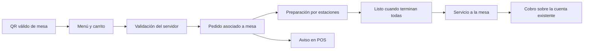
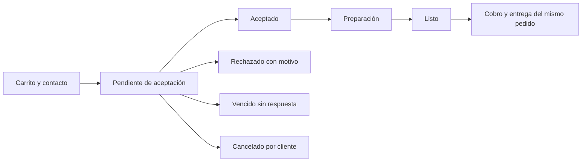
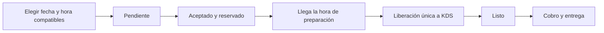

# Flujos y reglas del menú digital

Los estados de este documento son **conceptuales**. La correspondencia con contratos, columnas y eventos se define al implementar. No constituyen nuevos valores SQL aprobados.

## Consulta y catálogo

1. Resolver negocio, sucursal y, cuando corresponda, mesa.
2. Mostrar el catálogo publicado y las modalidades disponibles.
3. Permitir buscar, filtrar categorías y abrir un producto.
4. Mostrar variantes, modificadores, extras e indicaciones permitidos.
5. Mantener un carrito y mostrar el total.
6. Validar productos, opciones, disponibilidad y total en el servidor al enviar.

Un cambio de precio o disponibilidad exige una revisión visible antes de confirmar. El precio del navegador no es la autoridad.

Publicar el menú y recibir pedidos son opciones independientes. Pausar pedidos conserva el menú y los pedidos existentes.

## Mesa por QR

El cliente no proporciona teléfono o correo obligatorios. El servidor comprueba la credencial y el estado operativo de la mesa. Un QR no permite seleccionar arbitrariamente otra sucursal.

El pedido pasa a preparación sin aceptación previa. Una cancelación posterior requiere intervención del personal, con los permisos aplicables.

## Recogida inmediata

- Pedir nombre, teléfono y correo. Mostrar los datos para que el cliente pueda corregirlos.
- “Pedido recibido” significa pendiente, no aceptado.
- El pedido pendiente no aparece como trabajo para cocina o barra.
- El POS avisa de nuevos pendientes con alerta sonora y contador. La bandeja separa pendientes, programados, en preparación y listos.
- El personal acepta o rechaza con motivo.
- La aceptación habilita una única proyección a KDS.
- El vencimiento impide una aceptación o preparación tardía sin una transición válida.
- El plazo concreto de aceptación depende de la configuración que falta cerrar.
- El plazo se configura por el alcance definido de negocio/sucursal en Dashboard. Debe tener un valor real antes de activar recogida inmediata.

Capturar teléfono o correo no verifica identidad. No vincular historial, saldo o lealtad por una coincidencia escrita.

## Recogida programada

Cada pedido tiene una sola fecha y hora de recogida. Las opciones deben ser compatibles con todos los productos del carrito.

| Regla | Función |
| --- | --- |
| Anticipación mínima | Tiempo necesario entre enviar el pedido y recogerlo. |
| Tiempo de preparación | Permite calcular cuándo liberar un pedido aceptado. |
| Horizonte máximo | Última fecha que admite el producto o la sucursal. |
| Límite de cancelación | Último momento para cancelar directamente un programado aceptado. |
| Calendario y zona horaria | Determinan aperturas, cierres, excepciones y horas válidas. |

Aplicar la anticipación más exigente y el horizonte más corto del carrito. La fórmula para cantidades y preparación combinada sigue pendiente.

El límite de cancelación directa termina, como máximo, al liberar a preparación. Mostrar fecha y hora concretas al cliente.

Los horarios **17:30 de recogida, 17:10 de preparación y 17:00 de cancelación** son ejemplos. No son valores globales.

La opción de admitir programados fuera del horario de atención sigue propuesta. Si se aprueba, deberá definir cuándo empieza el plazo de aceptación.

## Cancelación

| Situación | Acción del cliente | Resultado |
| --- | --- | --- |
| Recogida pendiente | Cancelar directamente. | Cancelado; no llega al KDS. |
| Inmediato aceptado | Solicitar cancelación. | Sigue activo hasta resolución del personal. |
| Programado aceptado, antes del límite y sin liberación | Cancelar directamente. | Se impide su liberación posterior. |
| Programado después del límite o ya liberado | Solicitar cancelación. | Sigue activo hasta resolución. |
| Mesa enviada a preparación | Pedir ayuda al personal. | Se aplica la autorización operativa correspondiente. |
| Cobrado o entregado | Usar el flujo comercial existente que corresponda. | No convertirlo en una cancelación pública de pedido pendiente. |

Aceptar, cancelar, vencer y liberar pueden ocurrir al mismo tiempo. La persistencia debe producir un solo resultado válido.

La solicitud de cancelación es distinta del estado del pedido. No basta cambiar una etiqueta del cliente. Al autorizar, POS y estaciones deben recibir el cambio.

El producto existente exige autorización específica para anular líneas que ya se prepararon. El nuevo flujo debe respetarla. Véanse research y pendientes.

No se aprobaron multas automáticas ni una ventana universal de dos minutos. El pago ocurre en el negocio.

## Preparación, cobro y origen

- Reutilizar el enrutamiento por producto y estación del KDS.
- Cada estación recibe sus productos y opciones.
- El agregado pasa a “Listo” al terminar todas las estaciones involucradas.
- Mantener modalidad “Comer aquí” o “Para llevar”. Registrar el origen digital por separado.
- No crear otra orden comercial al adoptar, cobrar o entregar el pedido en POS.
- Un cliente que no recoge no se registra automáticamente como venta cobrada.

## Dashboard

| Área | Contenido esperado |
| --- | --- |
| General | Publicación, recepción, modalidades, pausa y vista previa. |
| Contenido | Visibilidad de productos, categorías, destacados y accesos al catálogo existente. |
| Pedidos y programación | Aceptación, anticipación, horizonte, cancelación y calendario. |
| Enlaces y QR | Enlace público, QR general y QR de mesas existentes. |

La sección se integra junto a Productos. Cada ajuste indica su alcance: negocio o sucursal. La precedencia exacta entre ambos niveles requiere definición técnica.

Las conexiones de correo pertenecen a Ajustes. Menú digital muestra su disponibilidad y los avisos habilitados.

## Correo y seguimiento

Enviar avisos de recepción pendiente, aceptación, pedido listo, rechazo, cancelación y vencimiento. Cada aviso identifica al negocio y enlaza únicamente al pedido.

El seguimiento web funciona aunque falle el correo. Un envío fallido no revierte un pedido ni crea otro.

La respuesta del proveedor acredita aceptación del envío, no entrega o lectura. Los rebotes, reintentos y respuestas del cliente requieren tratamiento explícito.

## Excepciones

| Caso | Conducta esperada |
| --- | --- |
| Reintento tras perder conexión | Recuperar el mismo resultado mediante idempotencia. |
| Producto agotado antes de aceptar | Rechazar con motivo visible. |
| Problema después de aceptar | El personal contacta al cliente y acuerda la solución. |
| Pausa del canal | Detener entradas nuevas y conservar pedidos existentes. |
| Sin personal o dispositivos durante atención | Detectar la condición y pausar pedidos inmediatos según política pendiente. |
| Pérdida de conexión después de aceptar | Conservar el pedido y recuperar la entrega a estaciones sin duplicados. |
| Enlace privado | Acceso limitado a un pedido, sin enumeración ni historial ajeno. |
| Abuso de formularios o correo | Límites de envío con alcance definido; no usar OTP como requisito implícito. |
