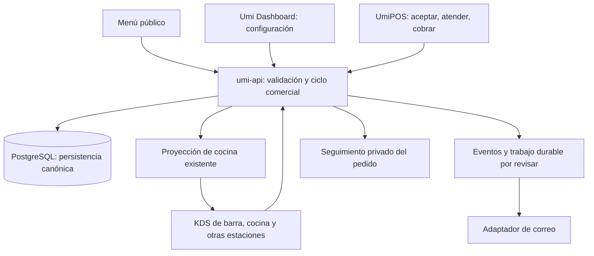

# Arquitectura e integración

## Dos entornos distintos

| Entorno | Qué contiene | Qué acredita |
| --- | --- | --- |
| Prototipo incluido | React, HTML/CSS, Stageshow, BoardUI y datos ficticios. | Diseño e interacciones simuladas. |
| Monorepo Umi | API, Dashboard, POS Flutter, contratos y persistencia. | Implementación real, según revisión y pruebas vigentes. |

No se aprobó un repositorio nuevo para el producto. La ubicación final del frontend público dentro de Umi se decidirá con sus límites actuales. No asumir que el HTML de demostración es la arquitectura final.

## Responsabilidades



Las cajas de eventos y liberación programada representan responsabilidades necesarias. No aprueban crear servicios nuevos. Evaluar primero los mecanismos existentes.

La recepción de un pedido, su preparación y su cobro son hechos distintos. El backend conserva su relación. KDS no sustituye la verdad comercial.

## Mapa del código real

Las rutas son relativas al clon de `umiconsulting/umi`. Se verificó su existencia el 4 de noviembre.

| Ruta | Responsabilidad y revisión necesaria |
| --- | --- |
| `apps/umi-api/src/modules/table-order/table-order.controller.ts` | API pública por credencial de mesa. Reutilizar sus límites de acceso. |
| `apps/umi-api/src/modules/table-order/table-order.service.ts` | Menú y creación de pedido. Revisar variantes, opciones, alcance y total. Conserva `VARIANT_NOT_AVAILABLE`. |
| `apps/umi-api/src/shared/orders/order-writer.ts` | Escritura comercial. Llama al proyector KDS; controlar el momento sin romper otros canales. |
| `apps/umi-api/src/modules/kds/kitchen-projector.ts` | Proyección y enrutamiento existentes. Evitar duplicar su responsabilidad. |
| `apps/umi-pos/lib/features/cart/incoming_orders_surface.dart` | Adopta pedidos en el carrito. No equivale a aceptación antes de preparar. |
| `apps/umi-dashboard/src/screens/products-hub.jsx` | Catálogo existente y navegación de productos. |
| `apps/umi-dashboard/src/screens/hours.jsx` | Horarios y pausa presentada como WhatsApp. Delimitar cada canal. |
| `apps/umi-dashboard/src/screens/orders.jsx` | Estados comerciales y origen. Extender de forma compatible. |
| `apps/umi-api/src/shared/adapters/email.adapter.ts` | SMTP, remitente y respuesta. Separar aceptación del proveedor de entrega. |
| `packages/contract/` | Contratos compartidos. Hay diferencias entre HEAD y origin/staging locales. |
| `packages/contract/src/table-order.ts` | Contrato público de mesa; documenta la limitación actual de variantes. |

El esquema observado el 1 de noviembre ya tiene `source`, `fulfillment_type`, `status`, `version` y `source_context`. Revisar relaciones y consumidores antes de añadir datos.

Mantener la compatibilidad durante despliegues escalonados de API, Dashboard y POS. Los nombres funcionales de la documentación no se convierten automáticamente en valores de contrato.

## Fronteras que deben conservarse

1. Validación de precio, opciones y disponibilidad en el servidor.
2. Alcance explícito de negocio y sucursal en configuración y escrituras.
3. Credencial de mesa y enlace de seguimiento con acceso limitado.
4. Idempotencia de envío y transiciones ante reintentos.
5. Aceptación y liberación controladas por el backend.
6. Cancelación coordinada con preparación, inventario y permisos.
7. Una sola orden comercial durante adopción y cobro.
8. Avisos desacoplados del resultado del pedido.
9. Pausa de entradas nuevas sin borrar trabajo existente.

## Cómo funciona el prototipo

```text
fuentes/
├── umipos-redesign/
│   ├── src/DigitalMenu.tsx            menú interactivo incrustado
│   ├── src/DigitalMenuShow.tsx        controles del recorrido
│   ├── src/MenuStaffPreview.tsx       Dashboard/POS/KDS de las escenas
│   ├── src/DevicePreview.tsx          marcos y dispositivos
│   ├── src/PreviewChoices.tsx         controles compartidos
│   ├── src/main.tsx                   aplicación y Workspace del POS
│   ├── src/Kitchen.tsx                KDS del prototipo
│   ├── src/dashboard/                 Dashboard del prototipo
│   ├── components/                    componentes BoardUI instalados
│   ├── styles/                        tokens y utilidades BoardUI
│   └── scripts/build-digital-menu.mjs sincronización y build vecino
└── umi-menu-preview/
    ├── .superpowers/brainstorm/18629-1793487079/content/
    │   ├── menu-v6.html               fuente del menú del cliente
    │   ├── menu-redesign.css          adaptación al diseño aprobado
    │   └── fotografías y fuentes
    └── flow/
        ├── examples/umi-flow/         escenas y puente del personal
        ├── playground/flow-data.ts    capítulos, modalidades y textos
        ├── playground/public/        adaptador y recursos de las escenas
        ├── scripts/sync-menu.mjs      copia HTML/CSS y ajusta rutas
        └── kit/                       Stageshow local
```

`build:menu` requiere que ambos directorios sean vecinos y con esos nombres. Genera `public/menu-digital/`, copia metadatos y construye el recorrido. El build principal produce `dist/`.

El adaptador de escenas añade correo y cambios de estado simulados. Esto explica por qué el recorrido muestra más pasos que el formulario interactivo real de la maqueta.

Las escenas del personal usan `/?embed=menu-staff` y mensajes entre ventanas. No llaman a una API comercial. `preview-state.js` conserva estado al cambiar de dispositivo en el visor.

## Despliegue futuro

El sitio `umi-stageshow` es un proyecto de demostración en Cloudflare Pages. No asumir que es el dominio comercial del menú.

La configuración de producto deberá definir dominio, rutas estables, API, política entre orígenes, caché, entornos y observabilidad. Los enlaces privados no deben quedar en una caché pública.

El proyecto actual usa Wrangler y publica `dist/`. No requiere credenciales para revisar localmente. La cuenta y los accesos de despliegue pertenecen a Umi, no al paquete.
