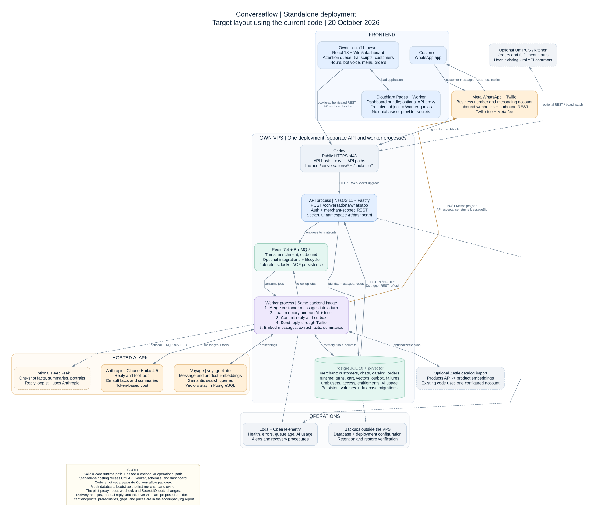

# Conversaflow standalone architecture and operating costs

Date: 20 October 2026. Currency: USD per month, before tax.

Conversaflow can use its own API, worker, PostgreSQL database, Redis, and dashboard deployment.
The current implementation belongs to Umi. A separate deployment can reuse that code and its database schemas.
A separate Conversaflow package would require additional engineering.

**Planning estimate:** about **$265/month for 1,000 conversations**, **$2,397 for 10,000**, or **$23,446 for 100,000**.
Each assumed conversation contains eight incoming messages and eight outgoing replies.
These amounts include the infrastructure budget, AI, embeddings, Twilio, and Meta service fees.
They exclude number rental, tax, labor, and optional campaigns. The assumptions and sensitivity range appear below.

## Diagrams and editable files

- [Complete architecture diagram](2026-10-20-conversaflow/architecture.svg).
- [Detailed diagram of one customer turn](2026-10-20-conversaflow/turn-flow.svg).
- [Endpoint inventory](2026-10-20-conversaflow/endpoints.csv): 57 HTTP routes, one Socket.IO namespace, six external APIs, and eight proposed routes.
- [Cost breakdown](2026-10-20-conversaflow/costs.csv) and [editable cost assumptions](2026-10-20-conversaflow/cost-model.json).
- [Official price evidence](2026-10-20-conversaflow-pricing-sources.md).
- Editable diagram sources: [architecture](2026-10-20-conversaflow/architecture.dot) and [customer turn](2026-10-20-conversaflow/turn-flow.dot).



## Scope and evidence

**Documented facts:** the implementation descriptions below come from the local `build-v3` source at commit `7e94eee0`.
The review covers Conversaflow and its required Umi modules. It does not cover every endpoint of every Umi product.
The older Supabase edge functions and logs dashboard are historical inputs.

**Inference:** the standalone deployment uses the current Umi API and Dashboard with an independent database and configuration.
It keeps the existing module boundaries. It does not require a new service for each tool or background job.

**UNVERIFIED:** the active production configuration, provider invoices, message volume, deployment capacity, and runtime behavior of a new standalone installation.
This work inspects code and public prices. It does not deploy or benchmark the application.

## Frontend components

The following rows describe **documented implementation facts**, except the hosting choice, which is a **planning inference**.

| Component | Purpose | Backend connection |
| --- | --- | --- |
| Customer WhatsApp app | Customer asks questions, selects products, edits a cart, and confirms an order | Meta and Twilio deliver messages to the webhook |
| Owner Dashboard | React 18 and Vite 5 application; sign-in, merchant selection, customer records, and transcripts | Cookie-authenticated REST |
| Attention screen | Lists customers whose last message awaits a reply | `GET /api/merchants/:merchantId/insights/triage` |
| Customer transcript | Displays customer, bot, and staff message types; loads older messages with a cursor | Transcript REST endpoint and Socket.IO refresh events |
| Configuration screens | Bot voice, business hours, locations, and catalog administration | Merchant configuration and administrative command routes |
| Orders screen | Displays commercial orders and permits authorized status changes | Merchant orders REST routes |
| Optional UmiPOS or kitchen client | Supports fulfillment through the existing Umi contracts | POS kitchen REST and board watch routes |
| Frontend host | Proposed Cloudflare Pages deployment of the dashboard bundle and its existing Pages Worker | Browser calls the API directly or through the Worker's same-origin proxy |

The transcript supports the display of staff messages. This does not establish an implemented staff reply composer or takeover API.
Those capabilities need the proposed additions below.

Sources: [Dashboard dependencies](../../apps/umi-dashboard/package.json), [attention screen](../../apps/umi-dashboard/src/screens/conversations.jsx),
[customer screens](../../apps/umi-dashboard/src/screens/customers.jsx), [data loaders](../../apps/umi-dashboard/src/data.jsx),
and [conversation subscription](../../apps/umi-dashboard/src/lib/conversation-realtime.js).

## Backend components

The following table records **documented facts** about the code. The single-VPS placement is a **planning inference**.

| Component | Responsibility | Runtime or data owner |
| --- | --- | --- |
| HTTPS proxy | Terminates TLS and forwards API and WebSocket traffic | Caddy |
| API process | Receives the WhatsApp webhook; serves authentication, settings, customers, orders, and realtime | NestJS 11 and Fastify; `node dist/main.js` |
| Merchant and identity services | Resolve the receiving number, merchant, customer, and WhatsApp contact | Umi identity and merchant modules; PostgreSQL |
| Turn worker | Groups messages, obtains a conversation lock, loads memory, and executes the AI tool loop | BullMQ; `node dist/worker.js` |
| Backend tools | Search the catalog; validate options and prices; change the cart; create or cancel orders | Conversation tool services and shared order writer |
| Memory services | Load recent messages, summary, customer facts, and semantic matches | PostgreSQL plus Voyage embeddings |
| Outbox relay | Moves committed reply events into the outbound queue | `runtime.outbox_event` and BullMQ |
| Outbound worker | Sends WhatsApp messages, retries failures, and records terminal failures | Twilio adapter; outbound queue; `runtime.dead_letter` |
| Enrichment worker | Embeds messages and products; extracts facts; updates summaries | Voyage and the configured one-shot LLM provider |
| PostgreSQL | Holds business facts, runtime state, vector data, authorization, and AI usage | PostgreSQL 16 with pgvector in the pilot deployment |
| Redis | Holds BullMQ jobs and conversation locks | Redis 7.4 with persistence |
| AI provider | Generates replies and selects tools | Claude Haiku 4.5, `claude-haiku-4-5-20251001` |
| Optional one-shot provider | Can serve facts, summaries, customer portraits, and other one-shot tasks | DeepSeek through `LLM_PROVIDER`; the reply loop remains on Anthropic |
| Optional catalog import | Reads a configured Zettle account and updates products and embeddings | Integration worker; current adapter uses one configured account |
| Operations | Logs, OpenTelemetry, health, backups, failure recovery, and provider bill reconciliation | Deployment and operations procedures |

The tool names are internal service calls. They do not each need a public HTTP endpoint:

```text
set_location                 get_merchant_info
get_business_hours           search_menu
add_to_cart                  edit_cart
confirm_order                confirm_order_changes
cancel_order                 get_recent_customer_orders
reorder_last_order
```

Sources: [API entry point](../../apps/umi-api/src/main.ts), [worker module](../../apps/umi-api/src/worker.module.ts),
[conversation module](../../apps/umi-api/src/modules/conversations/conversations.module.ts),
[tool definitions](../../apps/umi-api/src/modules/conversations/tools/tool-definitions.ts),
[order writer use](../../apps/umi-api/src/modules/conversations/orders.repository.ts),
[pilot containers](../../deploy/pilot/compose.yml), and [provider adapters](../../apps/umi-api/src/shared/adapters/adapters.module.ts).

### Database boundaries

These are **documented facts** from the current repositories:

| Schema | Relevant data |
| --- | --- |
| `merchant` | Customers, contacts, integrations, locations, hours, conversations, messages, customer facts, products, options, and orders |
| `runtime` | Conversation turns, draft carts, selected location, message and product embeddings, inbound events, outbox, idempotency, and dead letters |
| `umi` | Users, merchant access, permissions, entitlements, channel types, and `ai_usage` |

PostgreSQL remains the authority for orders and customer history. Redis is the queue and lock store.
Vector search uses PostgreSQL. A separate vector database subscription is an optional architecture change.

Sources: [conversation repositories](../../apps/umi-api/src/modules/conversations/conversations.repository.ts),
[identity adapter](../../apps/umi-api/src/modules/conversations/identity.repository.ts),
[memory queries](../../apps/umi-api/src/modules/conversations/memory.repository.ts),
[product queries](../../apps/umi-api/src/modules/conversations/products.repository.ts),
[queue repository](../../apps/umi-api/src/jobs/queue.repository.ts), and [AI usage records](../../apps/umi-api/src/shared/usage/ai-usage.repository.ts).

## What happens for one customer turn

These steps describe the **documented code path**.

1. Twilio posts form fields to `POST /conversations/whatsapp`.
2. The API validates the signature and resolves the merchant and customer.
3. The API checks the input, prevents duplicate messages, stores the customer text, and enqueues `turn.integrity`.
4. The webhook returns empty TwiML. The worker prepares the reply asynchronously.
5. The integrity worker groups nearby messages, with a hold window of one to three seconds.
6. The turn worker obtains a conversation lock and loads the cart, merchant voice, hours, and location context.
7. Memory includes the last eight messages, customer facts, summary, and up to five retrieved memories.
8. Haiku executes the tool loop with a configured budget of four tool calls. Automatic checks can add calls.
9. Backend tools validate and execute catalog, cart, and order operations.
10. The worker checks for newer customer text before it commits the reply.
11. One PostgreSQL transaction inserts the bot message and its outbox event, with a reply idempotency key.
12. The relay enqueues outbound work. The outbound worker calls Twilio and receives a message SID upon acceptance.
13. Background jobs embed the messages, extract customer facts, and update the summary when enough history exists.
14. PostgreSQL notifications cause a dashboard event. The browser then reads the authorized transcript over REST.

The current turn path does not call `IntentService.extractIntent`. A registered intent service is not an extra AI call per turn.
Repeated reply-loop calls and background facts and summaries do incur AI usage.
The automatic reorder lookup precedes the tool budget check. The configured budget is therefore not a strict execution limit.

The outbox acknowledgment means that BullMQ accepted the job. Twilio acceptance means that Twilio accepted the send request.
Neither event establishes delivery or a read receipt. A provider status callback supplies that evidence.

Sources: [webhook](../../apps/umi-api/src/modules/conversations/whatsapp.controller.ts),
[integrity timing](../../apps/umi-api/src/modules/conversations/turn-integrity.logic.ts),
[turn orchestration](../../apps/umi-api/src/modules/conversations/turn.service.ts),
[tool loop](../../apps/umi-api/src/modules/conversations/tool-loop.service.ts),
[reply transaction](../../apps/umi-api/src/modules/conversations/turn-commit.repository.ts),
[outbox relay](../../apps/umi-api/src/jobs/outbox-relay.service.ts),
[outbound processing](../../apps/umi-api/src/jobs/outbound.processor.ts),
[enrichment](../../apps/umi-api/src/jobs/enrichment.processor.ts),
and [realtime listener](../../apps/umi-api/src/modules/realtime/message-notify.listener.ts).

## Endpoint map

All routes in this section are **implemented in the reviewed source**.
The [CSV inventory](2026-10-20-conversaflow/endpoints.csv) gives full paths, source lines, authorization, and optional or compatibility classifications.

The table uses these abbreviations:

```text
M = /api/merchants/:merchantId
C = M/customers/:contactId
T = C/conversations/:conversationId
```

| Purpose | Method and route | Access or behavior |
| --- | --- | --- |
| Customer message ingress | `POST /conversations/whatsapp` | Twilio signature; form body; returns TwiML |
| Sign-in and MFA | `POST /api/auth/local/login`; `POST /api/auth/local/mfa/verify` | Credentials, then MFA when applicable |
| Session lifecycle | `POST /api/auth/local/refresh`; `POST /api/auth/local/logout`; `GET /api/auth/me` | Cookie session flow |
| Password recovery | `POST /api/auth/local/forgot-password`; `POST /api/auth/local/reset-password` | Configured recovery flow and email transport |
| Merchant selection | `GET /api/me/merchants`; `GET M/capabilities` | Authenticated membership |
| Initial deployment setup | `POST /api/platform/bootstrap/initial-merchant` | Bootstrap token and valid expiry; creates the first merchant, location, and owner |
| Merchant provisioning | `POST /api/merchants` | Platform administrator; initial setup |
| Business settings | `GET`, `PATCH M/settings` | Merchant membership and route-specific authorization |
| Locations | `GET`, `POST M/locations`; `GET M/locations/profiles`; `PATCH M/locations/:locationId` | Merchant and location scope |
| Optional address lookup | `GET /api/geocode` | Uses the geocode adapter |
| Customer directory | `GET M/customers`; `GET C` | Dashboard entitlement and `customer.read` |
| Customer history | `GET C/timeline`; `GET C/conversations`; `GET C/orders`; `GET C/identity` | Authorized customer scope |
| Transcript | `GET T/messages?limit=30&cursor=...` | Cursor loads older messages |
| Optional Cash details | `GET C/cash` | Customer profile integration with Umi Cash |
| AI customer portrait | `GET C/description` | Additional one-shot AI use when generated |
| Customer statistics | `GET M/insights/customer-platform` | Dashboard entitlement and `customer.read` |
| Attention queue | `GET M/insights/triage` | Customers who await a reply |
| Bot voice | `GET`, `PATCH M/conversaflow/voice` | Session and merchant membership |
| Hours and ordering policy | `GET`, `PATCH M/conversaflow/hours?locationId=...` | `merchant.manage` and location scope |
| Catalog reads | `GET M/operations?domain=catalog` | `catalog.read` and domain policy |
| Catalog writes | `POST M/administrative-commands` | Operations `catalog.create`, `catalog.detail`, `catalog.update`, `catalog.archive` |
| Category management | `GET`, `POST M/catalog/categories`; `PATCH M/catalog/categories/:categoryId` | Existing category services and policy |
| Orders | `GET M/orders`; `POST M/orders/:orderId/transition` | Dashboard entitlement and `kitchen.read` |
| Live transcript refresh | Socket.IO namespace `/rt/dashboard`; transport path `/socket.io/` | Event `dashboard.conversation.message`; authorized merchant room |
| Compatibility routes | `GET /api/:merchantRef/admin/conversations`; `GET`, `PATCH /api/:merchantRef/admin/hours` | Existing reference-addressed interfaces |
| Operations | `GET /health`; `/health/live`; `/health/ready`; `/health/release`; `/health/diagnostics` | Diagnostics requires the operations token |

The optional POS kitchen routes use `/api/v1/pos/merchants/:merchantId/kitchen`:

- `GET /orders/:sourceOrderId`.
- `GET /board` and `GET /board/watch`.
- `GET /all-day`.
- `POST /command`.

The optional POS catalog routes expose categories, products, and product details.
POS device enrollment and payment interfaces belong to that separate integration scope.

### External endpoints

These are **documented integration facts** from the adapters and their SDK use.

| Provider | Method and URL | Purpose |
| --- | --- | --- |
| Anthropic | `POST https://api.anthropic.com/v1/messages` | Reply loop and default one-shot AI tasks |
| Voyage | `POST https://api.voyageai.com/v1/embeddings` | Product, message, and query embeddings |
| Twilio | `POST https://api.twilio.com/2010-04-01/Accounts/{AccountSid}/Messages.json` | WhatsApp sends |
| Optional DeepSeek | `POST https://api.deepseek.com/chat/completions` | Configurable one-shot provider |
| Optional Zettle | `GET https://products.izettle.com/organizations/self/products/v2` | Catalog import |
| Optional Nominatim | `GET https://nominatim.openstreetmap.org/search` | Location setup lookup |

SMTP and the configured OpenTelemetry exporter are additional deployment connections.
Their hosts depend on the selected services.

### Proposed endpoints for additional capabilities

The following routes are **design inferences**, not implemented APIs. The CSV marks every row as `PROPOSED`.
Only the capability selected for the product requires its corresponding addition.

| Capability | Proposed route | Required backend work |
| --- | --- | --- |
| Delivery and cost reconciliation | `POST /conversations/whatsapp/status` | Validate callbacks; store delivery status and provider identifiers |
| Staff replies | `POST M/conversations/:conversationId/messages` | Authorize staff; persist messages; use the same outbox |
| Human takeover | `PATCH M/conversations/:conversationId/control` | Assign staff; pause and resume bot processing |
| Business-number setup | `GET`, `PATCH M/conversaflow/channel` | Manage provider state and number binding |
| Cost dashboard | `GET M/conversaflow/usage` | Aggregate AI and provider usage for the requested period |
| Failure recovery | `POST M/conversaflow/jobs/:jobId/retry` | Authorize and audit a safe, idempotent recovery |
| Optional proactive messages | `POST M/conversaflow/templates/send` | Add approved-template sending to the adapter and campaign workflow |

The current Twilio adapter sends a plain `Body`. Out-of-window messages require the provider's template mechanism.
The current adapter does not send `ContentSid`. Lifecycle automation therefore needs template support before that use.

## Standalone deployment prerequisites

The code requirements below are **documented facts**. The deployment layout is a **planning inference**.

1. Give the API its own HTTPS hostname and configure the dashboard's API origin.
2. Route `/conversations/*`, `/api/*`, `/health*`, and `/socket.io/*` to the API, with WebSocket support.
3. Run the API and worker as separate processes from the same backend image.
4. Provision PostgreSQL, pgvector, the canonical schemas, migrations, users, permissions, and entitlements.
5. Configure the application and worker database roles, database TLS, and the PostgreSQL CA.
6. Configure persistent Redis and the worker queues.
7. Configure the Anthropic, Voyage, and Twilio credentials for this deployment.
8. Set `TWILIO_WEBHOOK_URL` to the exact public webhook URL that Twilio signs.
9. Bind the business number through a connected `merchant.integration` row for provider `twilio`.
10. Configure the outbound sender with `TWILIO_WHATSAPP_FROM`.
11. Bootstrap the first merchant, location, and owner. Seed the catalog, hours, voice, and required authorization data.
12. Configure deployment secrets, release identity, the operations token, and the OpenTelemetry endpoint.
13. Establish external backups, restore verification, alerts, and provider cost reconciliation.

**Documented deployment gap:** [the pilot Caddyfile](../../deploy/pilot/Caddyfile) forwards only `/api/*` and health paths to the API.
It sends the WhatsApp webhook and Socket.IO transport paths to the dashboard fallback.
That file requires route changes for the diagram's layout.
[The API-specific Caddyfile](../../apps/umi-api/Caddyfile) already proxies all paths on its API hostname.

**Documented configuration dependency:** the current monolith requires shared Umi secrets even for a Conversaflow-only deployment.
These include QR, customer session, MFA, customer-value, bootstrap, and release settings.
The complete production validation list is in [config.schema.ts](../../apps/umi-api/src/shared/config/config.schema.ts).
An independent product package would need a separate boot configuration and module review.

**Documented setup dependency:** `POST /api/platform/bootstrap/initial-merchant` accepts `X-UMI-Bootstrap-Token` before the first sign-in.
It also checks `PILOT_BOOTSTRAP_EXPIRES_AT`.
Later merchant provisioning requires an authenticated platform administrator.
An explicit seed procedure can supply the initial account instead.
Source: [bootstrap service](../../apps/umi-api/src/modules/platform-bootstrap/platform-bootstrap.service.ts).

**Documented access detail:** the realtime gateway currently requires `kitchen.diagnostics`, while customer REST reads require `customer.read`.
The standalone staff role must account for that difference, or the gateway policy must change.
See [gateway authorization](../../apps/umi-api/src/modules/realtime/dashboard-realtime.gateway.ts).

The default outbox relay setting is enabled. Lifecycle campaigns and KDS status notifications default to disabled.
Use the validated configuration as the authority; some older code comments describe previous defaults.

## Operating cost assumptions

The rates below are **documented facts**, checked against official sources on 20 October 2026.
The [price evidence note](2026-10-20-conversaflow-pricing-sources.md) records source URLs and discrepancies.

| Charge | USD list rate |
| --- | ---: |
| Haiku 4.5 input tokens | $1 per million |
| Haiku 4.5 output tokens | $5 per million |
| Voyage 4-lite | $0.02 per million tokens |
| Twilio incoming messages | $0.005 each |
| Twilio outgoing messages | $0.005 each |
| Meta Mexico service messages | $0.0085 per delivered message after the allowance |
| Meta Mexico marketing messages | $0.0397 per delivered message |
| Cloudflare static dashboard requests | $0 within product limits |

Meta resumed service-message charges on **1 October 2026**.
Each business number receives **1,000 free service messages per month**.
Meta charges for outgoing service messages after that allowance. Twilio still charges for incoming and outgoing messages.
The estimate uses ordinary business pricing for Mexican recipients.
The separate AI Provider classification and other recipient markets can change the applicable rates.

Sources: [Anthropic](https://platform.claude.com/docs/en/about-claude/pricing),
[Voyage](https://docs.voyageai.com/docs/pricing),
[Twilio](https://www.twilio.com/en-us/whatsapp/pricing),
[Twilio country rate card](https://www.twilio.com/content/dam/twilio-com/pricing-data/en/WhatsAppPricing-pricing-details.csv),
[Meta effective rules](https://developers.facebook.com/docs/whatsapp/pricing),
and [Cloudflare](https://developers.cloudflare.com/pages/functions/pricing/).

**Documented frontend dependency:** the dashboard includes an advanced-mode Pages Worker, which also handles requests for static assets.
The frontend estimate assumes its requests remain within the Free quotas.
Paid Worker use adds at least $5/month and applicable usage charges.
Sources: [existing Worker](../../apps/umi-dashboard/public/_worker.js),
[advanced mode](https://developers.cloudflare.com/pages/functions/advanced-mode/),
and [Workers prices](https://developers.cloudflare.com/workers/platform/pricing/).

### Usage unit

These are **planning assumptions**, not measured averages:

- One conversation contains eight incoming messages and eight outgoing replies.
- All outgoing replies are delivered service messages within an open customer service window.
- One business number serves Mexican recipients. Its monthly service allowance is available.
- Total AI use is 60,000 input tokens and 5,000 output tokens per conversation.
- Those totals include all reply-loop calls, tool payloads, facts, and summaries.
- Embeddings consume 2,000 tokens per conversation.
- The estimate applies ordinary input prices and excludes cache and batch discounts.
- The estimate conservatively excludes Voyage's initial free token allowance.
- Extra staff portraits, campaigns, order notifications, payment fees, and ads are outside this message and token budget.

The cost unit is not a Meta tariff session. A durable conversation row can span multiple cost units.

```text
N = assumed conversations per month

AI      = N × ((60,000 × $1 + 5,000 × $5) / 1,000,000)
        = N × $0.085
Voyage  = N × 2,000 / 1,000,000 × $0.02
        = N × $0.00004
Twilio  = N × 16 × $0.005
        = N × $0.080
Meta    = max(N × 8 - 1,000, 0) × $0.0085

Monthly cost = infrastructure budget + AI + Voyage + Twilio + Meta
```

### Monthly standalone estimate

Every result in this table is a **calculated planning estimate** from the stated assumptions.

| Monthly cost | 1,000 conversations | 10,000 conversations | 100,000 conversations |
| --- | ---: | ---: | ---: |
| API, worker, database, Redis, backups, and operations reserve | $40.00 | $75.00 | $150.00 |
| AI | $85.00 | $850.00 | $8,500.00 |
| Embeddings | $0.04 | $0.40 | $4.00 |
| Twilio | $80.00 | $800.00 | $8,000.00 |
| Meta service fees | $59.50 | $671.50 | $6,791.50 |
| **Estimated total** | **$264.54** | **$2,396.90** | **$23,445.50** |
| Budget with 20% contingency | $317.45 | $2,876.28 | $28,134.60 |

The infrastructure budgets use a single VPS with local PostgreSQL and Redis, plus a static frontend.
The $24 and $48 server references are verified DigitalOcean list prices. Weekly backups add 20%.
Remaining amounts reserve funds for a domain, external backup storage, and monitoring.
The $96 server line in the largest scenario is an assumed allowance, not a verified quote.

These budgets do not establish capacity for each volume.
Peak message rate, worker concurrency, retained history, and vector storage determine the required server size.
A deployment with multiple servers or high availability needs a separate infrastructure estimate.

Sources: [DigitalOcean server prices](https://www.digitalocean.com/pricing/droplets)
and [backup prices](https://docs.digitalocean.com/products/backups/details/pricing/).

Supabase Pro is an optional managed database alternative, from $25/month with the stated compute credit conditions.
It adds a managed database charge while the API and worker still need hosting.
It is excluded from this self-hosted database baseline.
Source: [Supabase prices](https://supabase.com/pricing).

### Sensitivity and extra messages

These are **calculated inferences** with the same eight incoming and eight outgoing messages:

| AI use per conversation | AI cost per conversation | Total at 1,000 conversations, with $40 infrastructure |
| --- | ---: | ---: |
| 30,000 input and 3,000 output tokens | $0.045 | $224.54 |
| Base: 60,000 input and 5,000 output tokens | $0.085 | $264.54 |
| 200,000 input and 12,000 output tokens | $0.260 | $439.54 |

After the service allowance, one extra outgoing service message costs about $0.0135 through Twilio.
Two extra order notifications therefore add about $27 per 1,000 orders.
One thousand marketing messages add about $44.70, before customer replies, AI use, and other charges.

For the base 10,000-conversation scenario, messaging costs $1,471.50 and AI costs $850.
Message count and AI history therefore matter more than a small difference in VPS price.

The present adapter has no explicit prompt-cache policy. Cache savings require implementation and usage verification.
Switching `LLM_PROVIDER` affects one-shot work; it does not replace the Anthropic reply loop.

### Replace assumptions with measured costs

**Inference:** use completed, representative conversations to establish an actual cost distribution before a commercial price commitment.

1. Read `umi.ai_usage` for reply, fact, summary, and portrait token totals by merchant and period.
2. Reconcile those rows against Anthropic or DeepSeek bills, including failed or superseded work.
3. Reconcile incoming and outgoing message counts against Twilio, with recipient market and message category.
4. Use delivery callbacks to verify Meta-chargeable sends and the free service allowance.
5. Record actual embedding use, retained storage, peak throughput, and backup costs.
6. Calculate cost per conversation and cost per completed order separately.

The AI usage writer catches database failures so bookkeeping cannot stop a customer reply.
Successful writes therefore do not guarantee a complete vendor bill record.
Source: [AI usage writer](../../apps/umi-api/src/shared/usage/ai-usage.repository.ts).

## Tool choice and verification

The work used the repository research and verification workflows.
No application behavior, deployed service, or provider account changed.

| Tool decision | Evidence and reason |
| --- | --- |
| Source navigation | ripgrep 15.2.0 and direct source reads. CodeGraph was absent from this workstation. |
| Diagram renderer | `@viz-js/viz` 3.31.0, with Graphviz 16.1.0. The MIT-licensed wrapper ran locally from a temporary download. |
| Diagram tool source | [Viz.js official API](https://viz-js.com/api/) documents the SVG renderer. The diagram data stayed local. |
| Tool adoption cost | No repository dependency or application migration. The fallback was editable diagram source. |
| Diagram preview | Installed Chromium headless shell rendered the SVG for visual review. |
| Cost arithmetic | Python 3.14.4 with standard-library Decimal; editable JSON assumptions and CSV output. |
| Price research | Official vendor documentation and country CSV, through the web tool and curl. The price note records fallback routes. |

Verification checks cover SVG generation, local source references, endpoint inventory classifications, and cost arithmetic.
They do not certify application startup, browser workflows, provider delivery, or production capacity.
