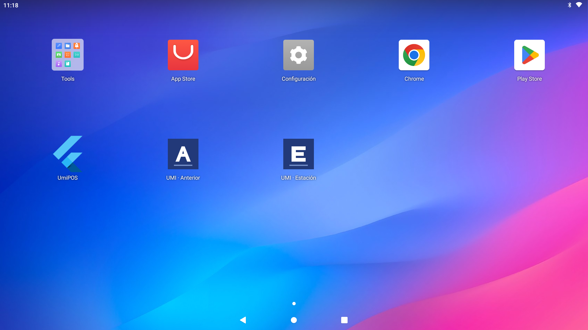

# Comparación de diseños en el iMin

Fecha: 2026-10-09. Equipo: iMin D3, Android 11, pantalla de 1920 × 1080, densidad de 220 dpi.

Las dos aplicaciones están instaladas y registradas. Ambas abren la carta y Ventas con los mismos datos de prueba.
Estación quedó abierta en la carta. La instalación habitual de UmiPOS conserva su APK, su UID y su fecha de actualización.

## Aplicaciones

| Icono | Nombre en Android | Paquete                             | Código de origen                                                                 |
| ----- | ----------------- | ----------------------------------- | -------------------------------------------------------------------------------- |
| A     | UMI · Anterior    | `co.umiconsulting.umi_pos.anterior` | Base previa al rediseño: `de883b38dd4bdc6550bef128cd6a5be79ffef399`              |
| E     | UMI · Estación    | `co.umiconsulting.umi_pos.estacion` | Fuentes actuales del repositorio principal, con las correcciones descritas abajo |

Anterior conserva la interfaz previa con Material. Estación usa los componentes propios y los colores UMI.
Los cambios de almacenamiento TPM permanecen separados de esta comparación.



## Uso

1. Abre el icono **A** para revisar el diseño anterior.
2. Abre el icono **E** para revisar Estación.
3. Usa el PIN **1111** si una aplicación solicita acceso. Este PIN pertenece al operador de prueba.
4. Compara la carta, la comanda y Ventas con el mismo negocio y sucursal.

Ambas aplicaciones usan la API de prueba del puerto 4013 y la base `umi_pos_estacion_design_20261008`.
La conexión pasa por la depuración inalámbrica. Mantén la computadora y la conexión ADB disponibles durante la comparación.
La instalación habitual conserva su conexión con la API del puerto 4001.

Si la conexión ADB se reinicia, restablece el enlace de prueba:

```sh
adb connect 192.168.1.10:5555
adb -s 192.168.1.10:5555 reverse tcp:4013 tcp:4013
```

Las aplicaciones tienen registros y almacenamiento separados. Sus datos comerciales proceden del mismo entorno de prueba.
Los APK proceden de bases de código distintas; esta revisión comprueba el diseño y los recorridos indicados.

## Evidencia en el equipo

Las capturas proceden de `adb exec-out screencap -p` en el iMin físico.
Ambas cartas muestran dos croissants, impuestos incluidos de MXN 13.24 y un total de MXN 96.00.

| Pantalla        | Anterior                                                                          | Estación                                                                       |
| --------------- | --------------------------------------------------------------------------------- | ------------------------------------------------------------------------------ |
| Acceso          | [PIN anterior](evidence/2026-10-09-imin-design-comparison/previous-pin.png)       | [PIN actual](evidence/2026-10-09-imin-design-comparison/current-pin.png)       |
| Carta y comanda | [Carta anterior](evidence/2026-10-09-imin-design-comparison/previous-catalog.png) | [Carta actual](evidence/2026-10-09-imin-design-comparison/current-catalog.png) |
| Ventas          | [Panel anterior](evidence/2026-10-09-imin-design-comparison/previous-sales.png)   | [Página actual](evidence/2026-10-09-imin-design-comparison/current-sales.png)  |

Ventas conserva el panel superpuesto en Anterior. Estación presenta Ventas como una página con navegación lateral.
La comparación verificó acceso, lectura de productos, comanda y lectura de ventas. Impresión, cajón y escáner quedan fuera de esta validación.

## Correcciones necesarias durante la instalación

El teclado de Android reduce la altura disponible. La pantalla de registro cambiaba de una fila a un formulario directo.
Ese cambio reemplazaba el editor y su nodo de foco. El teclado se cerraba antes de escribir el código.
La prueba reprodujo el reemplazo del nodo de foco antes de la corrección.

La pantalla ahora conserva el formulario dentro de una fila con una clave estable.
El panel de marca puede desaparecer cuando abre el teclado; el editor conserva el foco y el texto.
La [captura del teclado](evidence/2026-10-09-imin-design-comparison/current-keyboard.png) confirma el resultado en el equipo.

El campo también activa la escritura desde todo su espacio visible. Los campos desactivados ignoran el toque.
Las pruebas verifican que el ajuste conserva la selección, la edición y una única llamada a la acción del campo.

Fuentes modificadas en el repositorio principal:

- [Distribución del acceso](../../apps/umi-pos/lib/features/entry/entry_surface.dart).
- [Área táctil del campo](../../apps/umi-pos/lib/core/theme/pos_fields.dart).
- [Regresión del teclado y la distribución](../../apps/umi-pos/test/pos_type_and_entry_test.dart).
- [Regresión del toque y del campo desactivado](../../apps/umi-pos/test/pos_field_touch_test.dart).

## Validación y procedencia

- **672 pruebas pasaron**. El análisis de Flutter terminó sin problemas.
- Ambos APK usan el modo `profile` y código Dart compilado para ARM64.
- Android asignó los UID 10135 y 10136 a las aplicaciones de comparación.
- El POS habitual conserva el UID 10133 y el APK instalado antes de esta comparación.
- Los hashes calculados en el iMin coinciden con los APK locales.
- La comprobación comparó 136 archivos de fuentes, fuentes tipográficas y entrada de pruebas con el repositorio principal. No encontró diferencias.
- Los registros de ambos procesos no contienen los marcadores de fallo examinados durante esta revisión.

| APK                     | SHA-256                                                            |
| ----------------------- | ------------------------------------------------------------------ |
| Anterior                | `07ca1d1dcc71b9966eef9a72425bbc8c60367e0ab75c551feccd6586660eaa61` |
| Estación                | `19551dd744bc0f1fff89a9249610340897dac771379fddfd98087ddadede324c` |
| POS habitual conservado | `31d9925c40f2cf30c1396432cc92b92e6a2b8122fa9c9c17af6677eac13d08e9` |

Los [artefactos](evidence/2026-10-09-imin-design-comparison/artifacts.json) contienen las rutas de los APK y los hashes del código AOT.
Las [entradas de compilación](evidence/2026-10-09-imin-design-comparison/build-inputs.json) identifican los archivos y los parámetros utilizados.
La [validación](evidence/2026-10-09-imin-design-comparison/validation.json) registra las herramientas y los recorridos comprobados.
El [manifiesto](evidence/2026-10-09-imin-design-comparison/manifest.json) permite comprobar cada archivo de evidencia.
Las credenciales y los registros de diagnóstico completos permanecen en el directorio privado de ejecución.

Herramientas: Flutter 3.47.5, Dart 3.13.4, ADB 37.0.0, Android Build Tools 36.0.0 y apksigner 0.9.
La compilación usa Gradle y Flutter. La instalación usa ADB y la comprobación de firma usa apksigner.

Hecho documentado: Android identifica cada aplicación mediante su `applicationId`.
La decisión para UMI fue asignar dos identificadores distintos y conservar el identificador del POS habitual.
La [documentación oficial de Android](https://developer.android.com/build/configure-app-module) explica esta propiedad y su relación con el espacio de nombres.
