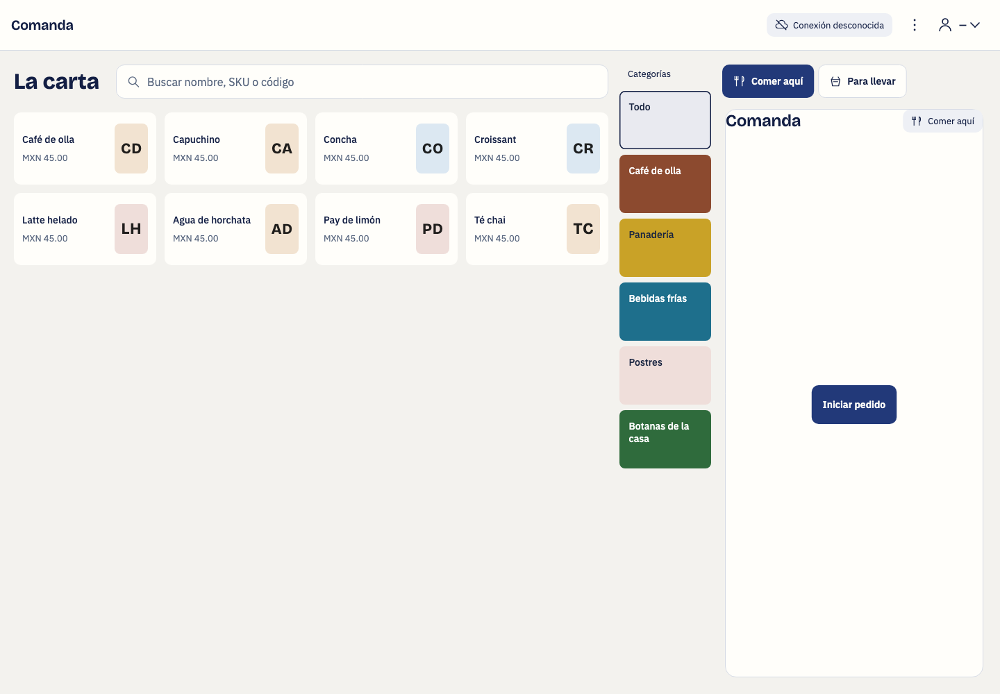
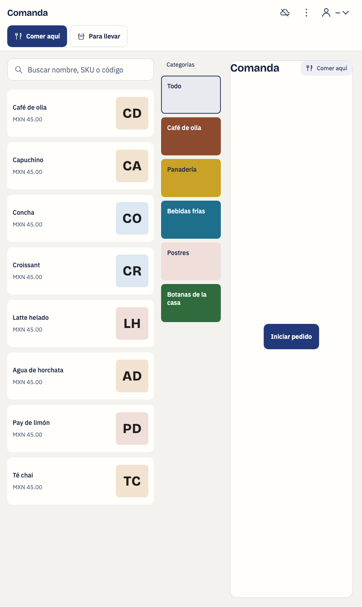

# Native POS presentation parity

## Approved mapping before edits

| Approved presentation | Native widget | Existing callback or state |
| --- | --- | --- |
| Products left, categories middle, account right | `_catalogBody`, `_CategoryTabs`, `_CartPanel` | `catalog.selectCategory`, `_showDetail`, existing cart callbacks |
| Restrained product rows and clear photos | `_content`, `_ProductCard` | Product availability, `_showDetail`, original options and extras |
| Category colors and readable labels | `_CategoryTabs`, `_ProductPlaceholder` | Explicit merchant colors, category name, selected category |
| Narrow checkout with fixed confirmation | `CheckoutSurface.build` | Existing tender fields, `_review`, `_confirm`, approval and unknown state paths |
| Partial payment with fixed charge and change | `PartialCheckoutSurface._checkoutBar` | Existing ledger, `_collect`, `_finalize` |
| Separate service tags on KDS | `_TicketCard` | Existing `fulfillmentType`, station filter, preparation callbacks |

## Visual direction

- Product: a native till for restaurant operators.
- Character: calm, exact, readable.
- World: a café counter and its account document.
- Moments: category colors and actual product photos.
- Signature: the account remains beside the menu on tablets.

Keep all original cash, table editor, hardware, domain, and API code unchanged.

## Implementation

The menu now uses three columns from 700 logical pixels. Products remain left, categories occupy 132 pixels, and the account remains right.
The account uses 280, 344, or 380 pixels according to the viewport width.
Phones retain their account action and horizontal category list.

Category labels retain their natural case. Independent 84-pixel category buttons replace overlapping folder shapes.
Merchant colors remain authoritative. Categories without colors use the approved pastel palette with a stable category-ID hash.
The palette contains `#dce8f2`, `#f2e3d1`, and `#efdeda`. The all-categories button uses `#e9eaf0`.
Dark mode blends category color into the native surface. Text contrast determines the foreground.

Product rows use 104 pixels at normal text size. Text scaling increases their height and reduces the column count.
Photos remain clear beside the product name and price. Missing photos retain the original initials fallback.
Unavailable products retain their warning, opacity, and refusal callback.

Checkout fields scroll above the confirmation action on phones. Larger screens retain the two-column payment layout.
Cash change wraps when labels and amounts exceed the available width.
Partial checkout places received cash and change together above its fixed charge action.
KDS service tags occupy a separate row above station and preparation status.

## Preservation

No controller, API command, permission, persistent-state rule, or hardware integration changed.
Options, extras, incoming orders, immutable sent lines, split payments, tips, and provider uncertainty retain their existing handlers.
The complete cash and table editor surfaces remain unchanged.

## Verification

- The selected native suite passed 312 tests. Its baseline contained 289 tests.
- The added geometry coverage checks six sizes: 402×874, 412×915, 820×1180, 800×1340, 1340×800, and 1440×1000.
- Analyzer output reported no issues for the changed source and test files.
- The macOS debug application built successfully with Flutter 3.47.5 and Dart 3.13.4.
- Native release configuration matched local API environment `test`, release `0.1.0`, and contract `2.50.0`.
- Local native instrumentation used a separate bundle, secure-storage namespace, and classic keychain account.
- The normal source configuration and generated platform files were restored after the build.

Full commands, artifacts, and native input limitations appear in `.superpowers/sdd/2026-11-02-redesign-parity/task-3-report.md`.

## Native input limitation

The macOS app reached its enrollment form. Flutter Driver commands returned success without a visible field-state change.
The OS input fallback was denied Accessibility access. No alternative path bypassed that denial.
Native operator workflows remain unverified here. The parent will complete this evidence with Android emulator input before final integration.

## Captures

The catalog captures use the existing widget render harness. They show fixture initials because its products have no photos.
The actual macOS runtime capture is [native enrollment](assets/2026-11-02-pos-redesign-parity/native-enrollment.png).
