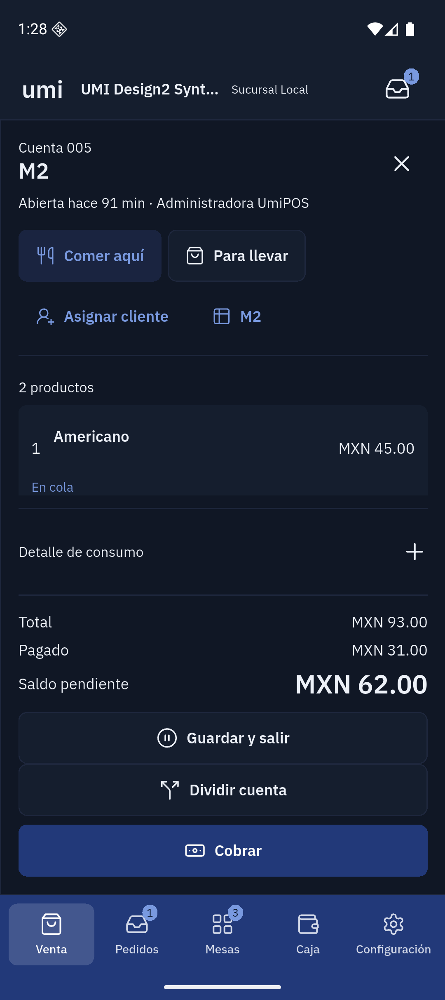
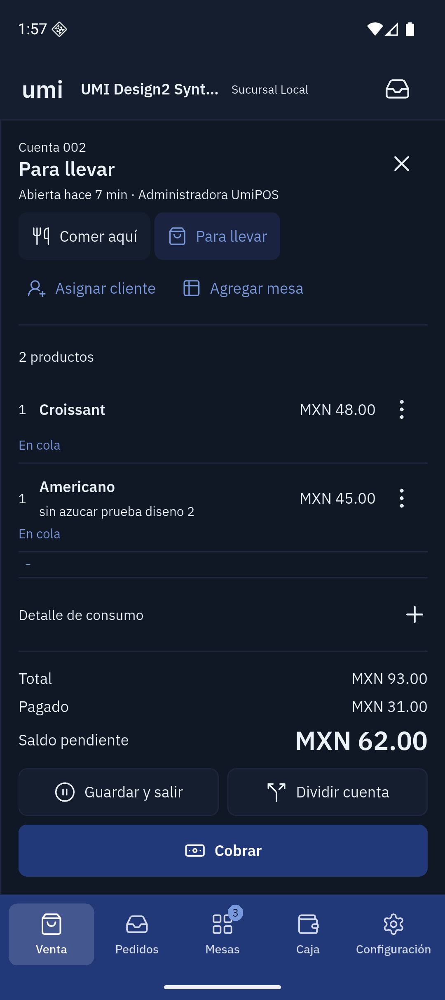

# Selected Rediseño 2: Android runtime evidence

## Current acceptance — 2026-11-04

The bounded native visual corrections passed source review and actual Android inspection.
This is a draft for team tests. Two baseline functional failures still block operational acceptance.
Physical hardware and real payment-provider authorization remain unverified.

Final product source: `2fd267ed8a014586ce58f26f9a773d8f7acd8fcb`.
Both visible Android AVDs have the same native development APK.
APK SHA-256: `b9c8b4f01e78bc4907cf8885a01f12aaa7d63544f701b1dc439f994b27f4bfcd`.
The isolated package is `co.umiconsulting.umi_pos.design2native20261104`.
Flutter 3.47.5 and Dart 3.13.4 built this APK with contract 2.51.0.
A fresh fetch confirmed `origin/staging` at `91aad948` on 2026-11-04.
No API, contract or database owner changed in this presentation branch.

### Final source checks

- Whole Flutter suite on exact product `2fd267ed`:1,292 passed, 5 existing Linux AppImage skips,0 failures.
- Full analyzer:0 errors, 0 warnings, 3 existing infos.
- E focused checks: 148 passed. Scoped analyzer: 7 files, 0 issues.
- Whole-branch review and scoped correction reviews passed. Native inspection remains separate from those source gates.
- Logs: `/private/tmp/umi-design2-corrections-full-e-final.log`, `/private/tmp/umi-design2-e-analyze-full.log`.

### Native results

| Check                                 | Observed result                                                                                                                                | Scope                                                                                                         |
| ------------------------------------- | ---------------------------------------------------------------------------------------------------------------------------------------------- | ------------------------------------------------------------------------------------------------------------- |
| Phone account                         | Both sent rows, operator note, total93, paid31 and due62 remain visible. Save and split share one row.                                         | Exact final APK.                                                                                              |
| Sent-line actions                     | Labelled line menu retains Repeat and Cancel.                                                                                                  | Native menu opened; source tests exercise the same owners and permissions.                                    |
| Phone partial payment                 | Account/due band and method keys precede the form. Portion31 and cash31 reached the ledger once.                                               | Exact final APK.                                                                                              |
| Operator note and quantity            | The note reached the server. Direct quantity reduction restored one Croissant before fire.                                                     | Exact final APK.                                                                                              |
| Interrupted connection                | The isolated API stopped. One quantity increase remained local, then reached the server after recovery.                                        | Exact final APK. No duplicate line appeared.                                                                  |
| Cold process restart                  | Enrollment persisted. After PIN entry, the normal account list recovered the same account with paid31 and due62.                               | Exact final APK. No enrollment reset or lost payment.                                                         |
| Cash completion                       | Remaining62, received100 and change38 finalized overall account7, daily folio002. Ticket0005 retained both products and the note.              | Exact final APK.                                                                                              |
| Drawer failure                        | The app retained the successful charge and showed its drawer warning.                                                                          | Exact final APK. No physical drawer pulse is claimed.                                                         |
| Portrait denomination count           | Bills and coins stayed parallel, with a fixed right total. The rail retained one umi mark.                                                     | Exact final APK at800 logical pixels.                                                                         |
| Blind count, reconciliation and close | Counted1,351.50 equalled expected1,351.50. Variance0. Outcome balanced. One shift-close row exists.                                            | Exact final APK. Server count resolved at ledger sequence11.                                                  |
| Physical map                          | Published geometry and occupied/paid-occupied states remained visible in portrait and landscape.                                               | Exact final APK.                                                                                              |
| Full portrait checkout                | Method bank, work area and304px account region stayed parallel.                                                                                | Inspected on4bc6589a. Its owner is unchanged in final E. No charge on account004.                             |
| Mixed takeaway                        | Overall account6 used Latte Mediano with oat milk87 and Croissant48. Cash45 plus explicit manual-terminal confirmation90 finalized ticket0004. | On4bc6589a. Final E preserves these business owners. No provider authorization is claimed.                    |
| Two-station completion                | Cocina completed while Barra retained queued Latte. Barra then completed.                                                                      | On4bc6589a. Server order completed at version8; both items completed at version4. KDS code is unchanged in E. |
| Station role                          | The preparation role exposed KDS and its allowed Settings, without cash/payment destinations.                                                  | On4bc6589a and final E. Station selection remains a display filter.                                           |
| Receipt output                        | Native Imprimir recibo delivered757bytes for ticket0003 to the synthetic TCP sink.                                                             | On4bc6589a. Physical printing remains unverified.                                                             |
| Hardware settings                     | Both synthetic TCP devices remained assigned after package updates.                                                                            | On4bc6589a. Hardware owner is unchanged in E. Physical USB/drawer hardware is absent.                         |

The final cash ledger has 11 entries. Its signed sum is 135,150 minor units.
Paid-out and safe-drop amounts have positive stored values and subtract from expected cash.
The manual-terminal amount contributes no cash. Final reconciliation confirms these rules.

The receipt payload hash is `3d263ebe12fbde9c8508edf39a606fda5e2db21f9201a0c821e3ed5a0b20e56e`.
No payload credentials, operator PINs or enrollment tokens appear in the evidence below.

### Native captures

These are real Android captures with synthetic business data. They are not Stageshow frames.
Final E captures require two consecutive identical screenshot frames. The before frame is the prior M1 build.

| Account before                                                                   | Account after                                                            |
| -------------------------------------------------------------------------------- | ------------------------------------------------------------------------ |
|  |  |

- [Phone sale](assets/2026-11-04-pos-design2-native/sale-phone.png)
- [KDS on landscape tablet](assets/2026-11-04-pos-design2-native/kds-tablet-landscape.png)
- [Phone partial payment](assets/2026-11-04-pos-design2-native/partial-phone.png)
- [Sent-line actions](assets/2026-11-04-pos-design2-native/line-actions-phone.png)
- [PIN after cold start](assets/2026-11-04-pos-design2-native/pin-phone.png)
- [Successful payment with drawer warning](assets/2026-11-04-pos-design2-native/completion-drawer-error-phone.png)
- [Portrait tablet count](assets/2026-11-04-pos-design2-native/count-tablet-portrait.png)
- [Closed shift](assets/2026-11-04-pos-design2-native/cash-closed-tablet-portrait.png)
- [Portrait table map](assets/2026-11-04-pos-design2-native/map-tablet-portrait.png)
- [Landscape table map](assets/2026-11-04-pos-design2-native/map-tablet-landscape.png)

Remaining device checks include physical hardware, provider outcomes, variance approval/handoff and live-merchant validation.
Table grouping/splitting retains source/test coverage; it has not completed a new native sequence in this final runtime.
The PIN uses enrolled identity. It does not invent business metrics before authorization.

### Account-switch refusal finding

The attempt to create another account while005 had a confirmed partial payment met the existing `CART_PAYMENT_UNRESOLVED` guard.
Replay classified that business refusal as nonretryable `server_validation_failed`. The refused commands were resolved in history.
The optimistic local account still showed lines as sent, although no corresponding server cart existed.
A subsequent normal recovery and settlement of005 succeeded. The fresh takeaway then reached the server normally.

Controller, queue, replay, API and contract owners match the staging baseline for this behavior.
C moves the service choice before the same baseline account-switch block. D/M1 change presentation only.
This is an open baseline functional failure. Keep the financial guard; correct refusal guidance and local reconciliation separately.
No payment guard, conflict or backend state was bypassed during this test.

Status: in progress. Native baseline `67bacd42`; first correction installed at `51eaab72`.
The visual comparison has 24 surface rows. Visual acceptance remains open.
The correction pass must receive a new build and runtime checks before acceptance.

## Test boundary

- Native Flutter 3.47.5, Dart 3.13.4. Android development APK, contract 2.51.0.
- Isolated package: `co.umiconsulting.umi_pos.design2native20261104`.
- Visible Pixel 9 phone: 1080×2424, density 420, normal text scale.
- Visible Pixel Tablet: 2560×1600, density 320. Portrait uses actual Android rotation.
- Isolated synthetic API: port 4186; PostgreSQL: 55438; Redis: 56386.
- Database: `umi_design2_native_20261104`. No production merchant writes.
- Input uses native controls. Flutter Driver targets fields by their actual labels.
- Flutter Driver text emulation supplies field text after Android key events proved unreliable in this harness.
- ADB supplies taps, scrolls, system rotation and screenshots. This does not certify the physical keyboard or IME.
- Database reconciliation uses a read-only transaction, scoped to the synthetic merchant.

## Observed behavior at checkpoint B

| Flow                     | Observed result                                                                                         | Evidence and limit                                                                                                                               |
| ------------------------ | ------------------------------------------------------------------------------------------------------- | ------------------------------------------------------------------------------------------------------------------------------------------------ |
| Open cash shift          | One MXN 1,000 bill produced a MXN 1,000 opening float.                                                  | Native input and stored opening denomination; shift remains open.                                                                                |
| Takeaway options         | Latte required a variant and a required milk option. Mediano and oat milk produced MXN 87.              | Add stayed disabled before required selections.                                                                                                  |
| Takeaway account         | Latte 87 plus Croissant 48 produced account 002 total 135.                                              | Stored lines retain the variant, milk modifier, note and service course.                                                                         |
| Preparation dispatch     | Both lines became sent. Editable line actions changed to their sent-line actions.                       | Actual kitchen projection has Barra and Cocina items.                                                                                            |
| KDS receive/start/ready  | Barra Latte and Cocina Croissant reached ready through native controls.                                 | Actual station item states and modifier/note text were inspected.                                                                                |
| KDS ready filter         | Hide ready (1) removed the ready lane. Show ready (1) restored it.                                      | `b-kds-ready-hidden-tablet-landscape.png`. The count remains one while hidden.                                                                   |
| Station sibling          | Completed Barra work leaves the Cocina projection available.                                            | Read-only reconciliation confirms Latte station completion and retained Croissant. A fresh complete sequence after corrections remains required. |
| Partial cash             | Half of 135 registered a confirmed cash tender of 67.50.                                                | Backend partial ledger and account remaining 67.50 agree.                                                                                        |
| Manual external terminal | Operator confirmation registered the remaining 67.50. Closing the account produced ticket 0001 for 135. | Local synthetic confirmation only. No payment provider or physical terminal authorization.                                                       |
| Dine-in cash             | M1 account 003 charged 48, received 100 and returned change 52.                                         | Native result and real receipt, ticket 0002.                                                                                                     |
| Paid table               | M1 remained Pagada y ocupada after payment.                                                             | `b-floor-paid-occupied-phone.png`.                                                                                                               |
| New consumption          | Nuevo consumo on paid M1 opened account 004 in the same seated visit.                                   | New Americano line was sent. Account remains open for further checks.                                                                            |
| Move and clean           | Moving M1 to M3 preserved account 004 and two people. M1 became Por limpiar; Mesa lista restored Libre. | Native map and account preview read actual state.                                                                                                |
| Printer configuration    | Registered and assigned a synthetic TCP printer through Settings. Printer preferences remain reachable. | Local socket sink on 127.0.0.1:9101, exposed only to this emulator through ADB reverse.                                                          |
| Printer connection test  | The connection test returned success.                                                                   | The socket accepted connections with zero payload bytes. This proves connection handling only. Receipt byte output remains pending.              |
| USB absence              | Discovery returned the supported no-printer message.                                                    | No physical USB printer is connected.                                                                                                            |
| Terminal drawer absence  | Discovery returned the supported unavailable-port message.                                              | The emulator exposes no supported physical drawer port.                                                                                          |
| Cash movements           | Entry 20, exit 10 and safe drop 5 each reached the cash ledger once.                                    | The first entry met a stale-version refusal after payments. Retry preserved both fields and used the refreshed version.                          |
| Blind count controls     | One 1,000 bill plus one 0.50 coin produced total 1,000.50.                                              | The count was cancelled. No count or close was submitted.                                                                                        |
| Public intake replay     | The same successful request returned the same order ID on replay.                                       | One table-order link and one source order exist. The cached response retains `created: true`; that flag alone does not prove uniqueness.         |
| Incoming binding         | Atender bound source order to account 005. Manual ring-up produced 93.                                  | Source lines and notes were not imported. See the functional failure below.                                                                      |
| Update persistence       | Installing correction A with `adb install -r` restored both enrollments and operator sessions.          | Both reached authorized screens. The phone catalog completed its initial load; no enrollment reset occurred.                                     |

The tablet kitchen role shows preparation and its allowed settings. It exposes no cash or payment destination.
Saved station selection remains a terminal display filter. It does not establish new per-staff station authorization.

## Visual evidence

The current B frames use `/private/tmp/umi-design2-android-b-*.png`.
Historical Task 3B captures use a different prefix and are excluded from current acceptance.
The audit is `.superpowers/sdd/2026-11-02-redesign-parity/task-3n-visual-fidelity-audit.md`.

Baseline differences include oversized modifier choices, excessive checkout header height, missing payment shell continuity,
the table detail modal, cash movement geometry, denomination count composition and Settings section geometry.
Some catalog frames are deliberately scrolled. Clipped edge rows in those frames do not establish missing products.

Correction A improves the ordinary phone sale, category density, account hierarchy and Settings section bank.
Current correction frames use `umi-design2-android-c1-*` and refer to `51eaab72`.
One source review finding remains: long account amounts at enlarged text need a width guard.
The remaining operational correction is not yet installed.

## Open functional failure: duplicate preparation after digital binding

The public table-menu order created its kitchen projection before POS binding.
Atender linked that source to account 005. It did not import source lines.
The operator manually added the same Americano and Croissant, then pressed Enviar a cocina.
That command created a second kitchen order with the same products at the same stations.

The read-only reconciliation identifies both projections:

- Original source: `fd43bf9f-838a-4928-8e6f-25dd5dd93317`; kitchen `7352c932-6a9f-4f9c-927f-fc401c34cf19`.
- Bound cart: `7d96ac71-6352-4d5d-8d1e-eb9cbe8c57dd`; fired order `1d0129a2-67d5-43ce-b4a2-8038ebee1367`.
- Second kitchen projection: `f30d350d-52ba-43a6-a3d0-ed15a1c7025f`.

The public replay itself created no duplicate. The duplicate arose at the later POS fire command.
API, contract and database owners have no changes in `91aad948..67bacd42`.
The public writer already projects preparation. POS `fire` uses its separate `fired_order_id`.
Origin binding records commercial attribution; it does not adopt prepared source lines.
These facts identify a pre-existing integration gap. They do not establish a visual-change regression.

This digital flow fails operational acceptance. Keep the presentation correction and this integration finding separate.
Do not mark the complete digital-to-kitchen-to-payment flow as passed.
No backend or contract correction has been made for this finding.

## Earlier checkpoint checklist (superseded where the current results give evidence)

- Install and inspect the full correction pass against the selected prototype.
- Repeat critical order, station, payment and cash sequences on that exact build.
- Resolve and retest the digital binding/preparation duplication above.
- Fresh two-station completion sequence with shared version reconciliation.
- Table group/split, release/clean and account refresh after another terminal changes the balance.
- Cash entry, exit, safe drop, blind denomination count, reconciliation and handoff.
- Receipt bytes, drawer error paths and hardware settings persistence.
- Offline replay, role refusals, standard dark mode, enlarged text and cold-start persistence.
- Phone, portrait tablet and landscape tablet visual acceptance.

Physical print output, an actual drawer pulse and provider authorization require their real devices.
The earlier enrollment reset remains unexplained. The subsequent correction-A package update preserved enrollment and operator state.
A separate device reboot remains pending.
