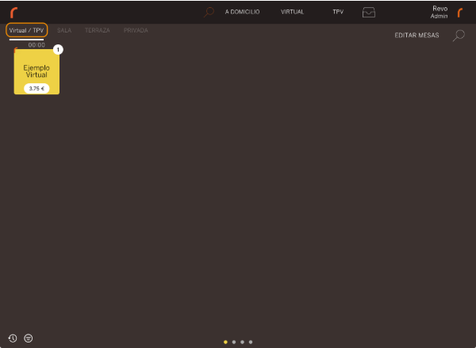
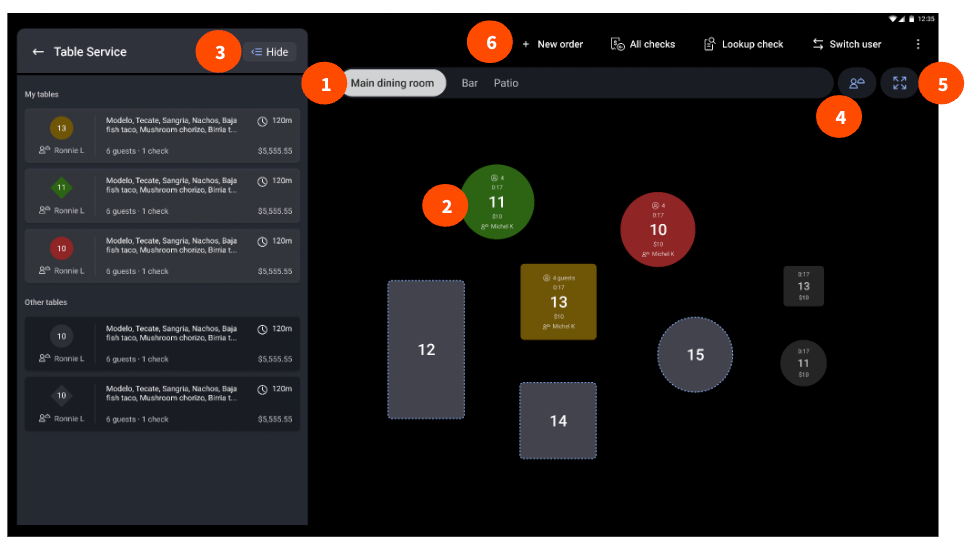
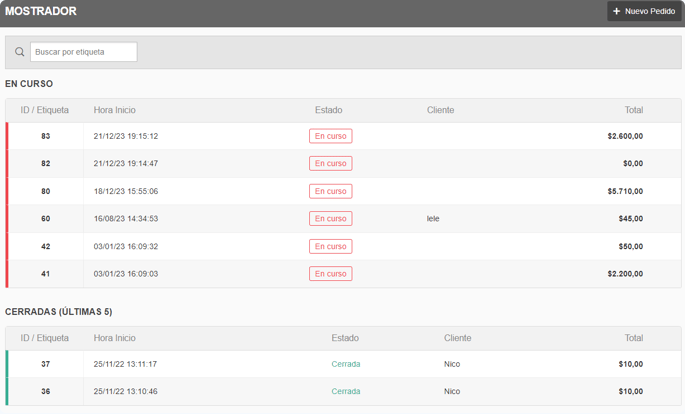

# Pantallas para pedidos con mesa y sin mesa

Consulta: 12 de octubre de 2026. Pregunta: ¿Cómo debe presentar Umi el acceso a una cuenta con mesa o sin mesa?

**Inferencia para Umi:** reunir las cuentas en una pantalla visible, con vistas de mesas y cuentas sin mesa. Ofrecer «Nueva cuenta sin mesa» desde ambas vistas. Mantener una sola pantalla de productos, con la ubicación y el nombre de la cuenta en su cabecera.

La decisión es la ubicación de las acciones de apertura y recuperación. Este pase complementa [Enviar, cobrar y portátil](2026-10-12-send-pay-handheld.md). Compara cuatro productos: REVO XEF, Toast, Fudo y Square. Las capturas corresponden a documentación pública, sin sesiones privadas de los proveedores.

[Galería ilustrada](2026-10-12-tableless-visual-flow/report.html) · [Índice de capturas](2026-10-12-tableless-visual-flow/assets/INDEX.md)

## Recorridos documentados

**Hecho documentado, REVO:** desde el plano, «Virtual» pide un nombre y los comensales. Después abre la pantalla de productos. El operador puede enviar a cocina o salir para guardar. Las cuentas aparecen en «Virtual / TPV» hasta el cobro. [Mesas virtuales](https://support.revo.works/es/articles/119).

**Hecho documentado, REVO:** el método de trabajo «Mesas virtuales» elimina las salas. Las cuentas creadas aparecen en el plano. Es un modo distinto de la sección virtual dentro de un plano normal. [Método de trabajo](https://support.revo.works/es/articles/711).

**Hecho documentado, Toast:** el mapa ofrece «New order» para abrir una cuenta sin mesa y «All checks» para recuperar cuentas. Seleccionar una mesa abre el pedido directamente cuando el panel lateral está oculto. Con el panel visible, primero aparece una vista previa. [Gestión de mesas](https://support.toasttab.com/en/article/New-POS-Managing-Tables).

**Hecho documentado, Toast:** «Set tab name» identifica la cuenta. Quick Order y Table Order comparten la estructura de productos, con diferencias en las acciones de cabecera. El menú incluye «Transfer to table». Send envía y regresa al mapa; Stay envía y conserva la pantalla del pedido; Hold conserva productos sin enviar. Estos controles dependen de la configuración. [Nombre de cuenta](https://support.toasttab.com/en/article/Starting-a-Tab-1492811100378), [pantallas de pedido](https://support.toasttab.com/en/article/New-POS-Experience-Ordering-Screens).

**Hecho documentado, Fudo:** «Mostrador» contiene «Nuevo Pedido». Cliente, camarero y comentario son opcionales. Los pedidos aparecen en un listado con identificador, hora, estado, cliente e importe. Mostrador tiene una orientación explícita a retiro y ventas directas. [Mostrador](https://soporte.fu.do/es/articles/11730844-7-mostrador-meson).

**Hecho documentado, Fudo:** para una mesa, el operador selecciona una mesa libre o busca su número. El panel exige la cantidad de personas antes de «Abrir mesa». La adición y el cierre comparten el procedimiento de Mostrador. [Abrir mesas](https://soporte.fu.do/es/articles/11730839-1-abrir-mesas), [Mostrador](https://soporte.fu.do/es/articles/11730844-7-mostrador-meson).

**Hecho documentado, Fudo:** el módulo adicional «Ventas por comensal» permite mover un pedido de Mostrador a una mesa. El recorrido usa Editar, «Mover pedido a mesa», número de mesa y personas. La fuente no prueba disponibilidad en el plan básico. [Ventas por comensal](https://soporte.fu.do/es/articles/11730673-modulo-de-ventas-por-comensal).

**Hecho documentado, Square:** una cuenta abierta puede crearse antes de añadir productos o al guardar una venta. Se recupera desde Tickets. El nombre y la nota pueden editarse después. El acceso a Tickets puede configurarse como pantalla inicial. [Cuentas abiertas](https://squareup.com/help/us/en/article/5337-use-open-tickets-with-square).

**Hecho documentado, Square:** Restaurants ofrece accesos «Checks» y «Floor plan». Su webinar oficial contiene pantallas de navegación y productos. Las imágenes son una referencia histórica de 2024; no prueban la interfaz de todas las versiones actuales. [Gestión de cuentas](https://squareup.com/help/us/en/article/8166-comp-void-and-reassign-checks-with-square-for-restaurants), [webinar oficial](https://community.squareup.com/t5/Community-News/Webinar-Recording-and-Recap-Stay-Productive-All-Service-with/ba-p/714672).

**Hecho documentado, Square:** en el portátil, seleccionar una mesa pide comensales. «Add to check» añade productos y «Send» envía a preparación. Volver a seleccionar la mesa permite modificar o cerrar la cuenta. [Pedido en mesa](https://squareup.com/help/us/en/article/8152-take-orders-tableside-with-square-for-restaurants-mobile-pos).

## Comparación

Todas las celdas describen hechos documentados, salvo «Sin verificar».

| Decisión visible        | REVO                              | Toast                               | Fudo                                    | Square                                                    |
| ----------------------- | --------------------------------- | ----------------------------------- | --------------------------------------- | --------------------------------------------------------- |
| Inicio sin mesa         | Virtual                           | New order / Quick Order             | Mostrador / Nuevo Pedido                | Tickets / New Ticket, o guardar la venta                  |
| Inicio con mesa         | Plano                             | Mesa del mapa                       | Mesa libre o número                     | Floor plan                                                |
| Recuperación sin mesa   | Tarjetas Virtual / TPV            | All checks                          | Listado Mostrador                       | Tickets / Checks                                          |
| Nombre                  | Diálogo al crear                  | Set tab name                        | Cliente opcional                        | Nombre del ticket                                         |
| Asignar mesa después    | Sin verificar en estas fuentes    | Transfer to table                   | Sí, documentado en módulo adicional     | Sin verificar para una cuenta sin mesa en estas fuentes   |
| Envío separado de cobro | Sí, cocina frente a guardar/salir | Sí, Send / Stay / Hold frente a Pay | No se resuelve en el artículo Mostrador | Sí en Restaurants portátil; Save ticket es otro recorrido |

## Señales de foros

**Testimonio, no hecho del proveedor:** un hilo de Toast pregunta cómo ordenar cuentas por nombre. La respuesta apunta al filtro de All checks. La recuperación necesita búsqueda y orden, además del nombre. [Tab names, marzo de 2024](https://www.reddit.com/r/ToastPOS/comments/1bf3k62/tab_names/).

**Testimonio, no hecho del proveedor:** otro hilo compara escribir un número como nombre con crear botones para números de entrega. Un participante advierte que un plano ficticio puede confundir al personal. [Tables with pylons, febrero de 2024](https://www.reddit.com/r/ToastPOS/comments/1ammbrh/tables_with_pylons/).

**Inferencia:** estos casos justifican estudiar la identificación y recuperación. No prueban que un producto sea más usable que otro. El pase anterior conserva veinte señales sobre operación portátil; aquí se añadieron dos hilos específicos. No se hizo una encuesta de reseñas.

## Aplicación a Umi

**Hecho local:** Umi presenta las cuentas abiertas en un diálogo. Cada fila reúne nombre, folio, fecha, creador, pendientes, enviados y saldo. [Implementación](../../apps/umi-pos/lib/features/cart/open_accounts_surface.dart:54), [captura física del build 32](../reports/evidence/2026-10-12-tableless-accounts/19-final-saved-accounts.png).

**Hecho local:** el panel de una cuenta sin mesa muestra «Nombre de cuenta» y «Asignar mesa». Las acciones operativas incluyen «Guardar y salir» y «Enviar». [Cabecera](../../apps/umi-pos/lib/features/catalog/catalog_surface.dart:3953), [acciones](../../apps/umi-pos/lib/features/catalog/catalog_surface.dart:4141).

**Inferencia de diseño:** hay demasiados datos secundarios al mismo nivel en la lista. Además, los accesos a mesa, cuenta nueva y recuperación requieren reconocer superficies distintas. Esta hipótesis coincide con la confusión reportada por Juan; requiere una prueba del nuevo recorrido en el iMin.

La propuesta para revisión es:

1. Mostrar «Cuentas» como superficie de trabajo, con vistas «Mesas» y «Sin mesa».
2. Mantener «Nueva cuenta sin mesa» y búsqueda visibles en esa superficie.
3. Usar nombre o mesa como título. Mostrar importe y tiempo como datos de comparación. Dejar folio y creador como información secundaria.
4. Mantener el mismo panel de productos. Mostrar «Mesa 4» o «Sin mesa · Ana» en su cabecera.
5. Ofrecer «Asignar mesa» en la cabecera de las cuentas sin mesa.
6. Explicar el resultado con «Enviar a cocina», «Guardar y salir» y «Cobrar». Al enviar, mostrar «Enviado · Cuenta abierta».

**Alternativa:** adoptar tarjetas virtuales al estilo REVO dentro del mapa. Ofrece una entrada clara y una sola superficie. Se prefiere una lista para Umi porque permite comparar muchas cuentas por nombre, importe y tiempo. Esta preferencia es una hipótesis de diseño.

**Diferencia entre proveedores:** Fudo orienta Mostrador a retiro; REVO usa virtuales para clientes sin mesa fija. Umi debe conservar separados «sin mesa» y «para llevar». Toast Send vuelve al mapa; Umi Enviar conserva actualmente el pedido. Cambiar ese regreso requiere decidir el comportamiento antes de copiar el botón.

**Se conserva del pase anterior:** cuenta persistente, mesa opcional, identidad de pedido, envío independiente de cobro y permisos por operador.

**Nuevo:** evidencia de las entradas, del nombre, de la recuperación y de la cabecera. Este pase propone una organización visual; no cambia la aplicación.

## Herramientas y alcance

**Instrumentos:** búsqueda y lectura web, `rg`, Playwright 1.62.1 (Apache 2.0), Chromium 153.0.8010.52 y Python 3.14.7. Playwright y Chromium ya estaban instalados. Se usó Chromium con interfaz en `DISPLAY=:0`. Las capturas de cada imagen conservan el encuadre de la documentación. No se fabricaron pantallas de los proveedores.

**Selección de herramienta:** la búsqueda localiza fuentes; Chromium confirma las pantallas renderizadas. No requiere instalar dependencias ni iniciar sesión. La alternativa es el HTML público y la URL de la imagen. El extractor inicial con BeautifulSoup falló por dependencia ausente; se recuperó con HTMLParser de Python. La resolución directa de `playwright` falló; se usó el paquete instalado `@playwright/test`.

**Rutas:** REVO, Toast, Fudo y documentación Square devolvieron HTTP 200 en Chromium. Square5337 publicó texto, sin captura de producto. Square8166 publicó dos diálogos de ajustes, no el recorrido de apertura. El webinar Square falló por timeout en lectura web; el HTML directo respondió 200. Chromium capturó la página, pero una imagen no visible bloqueó la captura individual. Se recuperó el mapa original por descarga HTTP 200. Los JSON de capturas conservan los resultados y las URLs de imágenes.

**Límites:** referencia pública, no prueba autenticada de cada POS. El pase anterior cubre cambios recientes y operación portátil. Aquí no se repitió una auditoría de seis meses, veinte reseñas o tres fuentes operativas. Las fuentes comerciales cerradas no ofrecen su código. CodeGraph no está disponible; `rg` vincula las afirmaciones locales. No se atribuye cumplimiento de una norma ni una mejora medida a estas pantallas.
