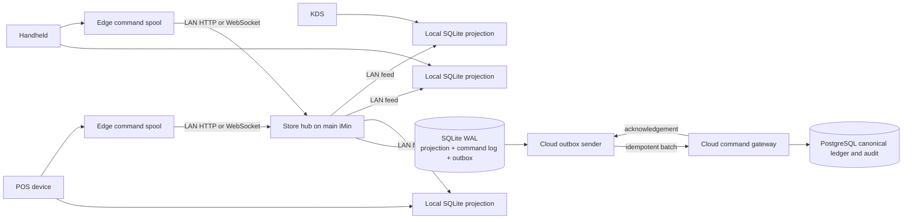

# Parrot reliability cascade

- Date: 2026-10-18
- Question: Which parts of Parrot's architecture make the point of sale
  responsive, recoverable, and supportable?
- Scope: reliability, local persistence, synchronization, multi-device behavior,
  diagnostics, and upgrade safety.
- Decision it informs: the clean command and synchronization architecture for
  UmiPOS.

## Result

Parrot's main advantage is not a specific screen or library. Its main advantage
is the placement of operational truth.

The till paints from a local Room database. A background service drains work.
The application carries a local network node and a device registry. Sync state is
visible. A trusted-time module supplies a clock that does not trust the device
clock. Telemetry and remote support are built into the product.

Umi should preserve these principles. Umi should not copy Parrot's row-sync
model for money. Row sync does not define the authority for one account. It does
not define command order for one account. It does not give a safe resolution for
two writers that change the same account.

The recommended Umi architecture is:

1. One local store hub on the main iMin.
2. One command log and one current projection in SQLite.
3. One writer and one revision sequence for each account.
4. One durable cloud outbox on the hub.
5. One visible health state on every screen.
6. No Redis or RabbitMQ on the interactive path.

This design keeps the customer experience local. It keeps money and audit truth
under server control. It keeps all unresolved history.

## Evidence method

Evidence classes:

- **APK**: observed in the shipped Android artifact by static analysis.
- **SRC**: read from public source code.
- **HD**: documented by a provider.
- **PAPER**: academic source.
- **ENG**: primary engineering or platform documentation.
- **HL**: Umi local evidence.
- **I**: inference.
- **NV**: not verified.

The Parrot APK is never executed. Method bodies from JADX are derived
representations. Runtime behavior and signatures remain unverified.

Tools:

- REA commit `d1adc607952472b6db87d1fe5af4ba241f759f6e`.
- JADX headless bridge `0.7.1`, SHA-256
  `6e5eacf500b64292bfb73c49797c1958f6ee44646e43e868039ae7feb573ff75`.
- Android SDK `apkanalyzer` and `aapt2`.

Artifacts:

| Artifact                 | SHA-256                                                            | Use                     |
| ------------------------ | ------------------------------------------------------------------ | ----------------------- |
| Parrot POS `2.27.5`      | `fdc0492cd7ea3107ec6e74bb520d21a0cc602ac015fba2f7aea449f8dc07d1c3` | Main APK evidence       |
| Flutter POS `3.1.0`      | `bc5ebd52e4157b0494333fc71aa5e1ad7839d5cbf552ee1d196e1c6191773d4c` | Open-source APK example |
| gPOS Mobile `0.1.0-beta` | `d0d627126ba8b3fc1e8b6a2fd37383c220f50ac17edfe0b3bd3f7996d1900dc3` | Open-source APK example |

## Iteration cascade

### C1. A local working copy keeps the tap local

**APK evidence.** Parrot contains a large Room database. It covers orders,
payments, tables, split checks, kitchen tickets, cash sessions, closing
summaries, taxes, service charges, and device roles. The application class,
foreground service, database entities, DAOs, and local API service are present
in the artifact.

**Cross-check.** FloCafe states that core orders, billing, KDS, and printing use
local SQLite. Square stores offline payments on the device. Toast uses a local
hub. Lightspeed uses an active device with a local cache.

**Principle.** The interaction surface must read and write local durable state.
A network response is synchronization, not interface completion.

**Umi rule.** A tap writes one SQLite transaction before the next frame. The
screen reads the new projection immediately. No tap waits for WAN.

**Acceptance.** P95 local paint stays below 50 ms during a 10,000-line catalog
run. Removing all WAN access changes sync status only. It does not change tap
response.

### C2. Sync state belongs to the record

**APK evidence.** Twenty-one operational Room tables contain `dbSyncStatus`.
The status values in the shipped enum are `DONE`, `PROCESSING`, `SENDING`,
`SYNC_REQUIRED`, and `VERIFY_UPDATED_AT`. The shared sync object exposes
`syncId`, `syncStatus`, and `syncUpdatedAt`.

**Cross-check.** FloCafe stores outbox rows with `pending`, `sending`,
`delivered`, `failed`, `attempt_count`, `next_attempt_at`, and `last_error`.
The outbox row survives process restart.

**Principle.** A record and its delivery state must not live in two independent
containers. A process crash must not erase the instruction to send.

**Umi rule.** Keep current business projections separate from an append-only
command log and a durable outbox. Do not put transport state in UI memory.

**Acceptance.** Kill the process after local commit and before network send.
Restart returns the exact command and status. A later send applies once.

### C3. Soft delete preserves the event of removal

**APK evidence.** Parrot includes deleted-state fields such as `isDeleted`.
The artifact also contains explicit sync states for records and commands.

**Cross-reference.** Local-first software identifies local ownership and
long-term preservation as core goals. FloCafe uses append-only migration rules
and fail-closed database replacement.

**Principle.** A missing row cannot tell another node that a deletion occurred.
A tombstone can. History must contain the removal event.

**Umi rule.** Do not hard-delete unresolved commands, conflicts, payments, or
account history. Use tombstones and append-only resolution events. Compact only
fully acknowledged non-financial data after a defined retention period.

**Acceptance.** An offline deletion replays after restart and reconnect. The
server receives one tombstone. Audit still shows the original object and the
deletion.

### C4. A scheduler drains work, not the user interface

**APK evidence.** Parrot uses WorkManager workers for uploads and sync work.
`SyncRepositoryImpl` merges 23 reactive sync streams. A state change selects a
channel worker. `UploadWorker` runs a channel task. The sync layer has a delay
per channel, and network helpers use bounded retry with exponential delay.

**Cross-check.** WorkManager persists work across process death and provides
constraints, retry, backoff, unique work, and observable progress. FloCafe uses
a serialized outbox flush with exponential backoff capped at 30 minutes.

**Principle.** Delivery is background work with durable state. It is not a
button await and it is not a fire-and-forget call.

**Umi rule.** One scheduler owns outbox draining. It uses one flush at a time,
bounded batches, exponential backoff with jitter, and typed terminal outcomes.

**Acceptance.** A 1,000-command backlog does not increase tap latency. The
scheduler survives restart. It sends no concurrent batch for the same stream.

### C5. The store network is part of the product

**APK evidence.** Parrot includes Ktor server modules with ports `4242` and
`4244`, NSD discovery, the `dnssd` library, a network device table, and role
tables for KDS and payment terminals.

**Cross-check.** Toast describes a local hub that relays updates between devices
and the cloud. Lightspeed defines active and passive devices. PoloTab sells the
router as part of its package. FloCafe serves POS, KDS, and server-app surfaces
over the local network.

**Principle.** A local node is the serialization point for shared accounts. It
also removes WAN from the critical path.

**Umi rule.** The main iMin runs the store hub. Peers use LAN discovery and a
stable hub identity. KDS and receipt delivery use the hub. The hub stores the
account sequence and the cloud outbox.

**Acceptance.** Cut WAN. Create an account, add items, fire a ticket, show it on
KDS, and mark it ready. All actions complete over LAN.

### C6. Device roles belong in the registry

**APK evidence.** Parrot stores `network_device` with role, address, port, and
status. `kds_device` and `pay_device` specialize the role. Kitchen areas and
expo status are attached to the KDS role.

**Cross-check.** Toast assigns a local hub automatically. FloCafe exposes
separate POS, KDS, and server-app origins. Umi already has device enrollment and
role data.

**Principle.** Network topology and authority must not be inferred from device
names or last-seen IP addresses.

**Umi rule.** A hub lease names one active main station. Each peer has one
explicit role. KDS writes name the hub and station. A stale address is not a
valid route.

**Acceptance.** Change a DHCP address and restart a router. Discovery resolves
the hub. A removed KDS role cannot receive tickets.

### C7. Trusted time prevents silent misordering

**APK evidence.** Parrot contains a TrueTime module, NTP host pool, timekeeper,
cache, `TIME_SET` and `TIMEZONE_CHANGED` receivers, and a time-verification
worker.

**Cross-reference.** SQLite and the server must agree on transaction order and
business time. Device wall clocks are user-controlled and can jump.

**Principle.** Ordering uses logical sequence and server time. Display uses the
store timezone. A wall-clock jump cannot reorder a sale.

**Umi rule.** Persist command sequence, server offset, and UTC time separately.
Never use an unvalidated device clock for payment or audit order.

**Acceptance.** Move the device clock forward and backward during a queue
drain. Sequence and business date stay correct.

### C8. Health must be visible at the point of work

**APK evidence.** Parrot has a Sync Status activity, a device overview, a
diagnostic activity, structured logger managers, Datadog RUM and logs,
Crashlytics, and remote support through Cobrowse.

**Cross-check.** Toast shows an offline banner and a dialog of available
actions. FloCafe exposes health, diagnostics, bounded delivery gaps, and a
support-ticket outbox.

**Principle.** The operator needs the current state and one next action. A
separate support screen is not enough. Remote diagnosis is a fallback.

**Umi rule.** Every account card and action shows local safety and sync state.
The hub also exposes the same state to support. A hidden queue is a defect.

**Acceptance.** Force a hub failure, cloud failure, printer failure, and
conflict. Each produces a visible state and one valid next action within one
second.

### C9. Recovery must preserve the previous state

**APK evidence.** Parrot uses a local database and sync-status records. The APK
does not expose a complete backup or restore contract in the inspected paths.
Its manifest sets `allowBackup="false"`.

**Cross-check.** FloCafe creates a pre-migration backup, refuses to recreate a
missing initialized database, refuses a newer schema, journals database
replacement, and keeps a safety copy of the database it replaces.

**Principle.** Upgrade and repair are write operations. They need their own
recovery record and backup.

**Umi rule.** Back up before every schema change. Refuse silent database
creation. Refuse a database newer than the application. Keep unresolved
commands across upgrades.

**Acceptance.** Interrupt a migration, a restore, and an application upgrade.
The system resumes or rolls back to the last valid state.

### C10. Observability must exclude sensitive payloads

**APK evidence.** Parrot contains multiple telemetry and logging managers. The
APK alone does not prove what each field contains.

**Cross-reference.** FloCafe sends a closed set of diagnostic codes, bounded
counts, UUID references, and allowlisted fields. Its documentation excludes
exception text, SQL, request paths, customer data, amounts, and transaction
references.

**Principle.** Diagnosis needs state transitions and correlation IDs, not raw
financial or customer payloads.

**Umi rule.** Log `command_id`, aggregate type, transition, latency, and safe
error class. Do not log tender values, customer PII, or credentials.

**Acceptance.** A support export reconstructs a failed command without exposing
the customer or the payment payload.

## Clean Umi architecture

### Topology



### Five invariants

1. **One local commit.** A tap writes durable local state before it paints.
2. **One account writer.** The hub serializes commands for each account.
3. **One command identity.** Every command has an immutable UUID and
   idempotency key.
4. **One outbox.** The hub owns cloud delivery. A device does not create a
   second cloud order stream.
5. **One visible health state.** The operator and support read the same state.

### Command contract

Every command carries:

```text
command_id
idempotency_key
account_id
device_id
operator_id
command_type
payload
expected_account_revision
created_at
schema_version
```

The hub applies the command in one SQLite transaction:

1. Check command identity.
2. Check account lease and revision.
3. Validate the transition.
4. Update the projection.
5. Append the audit event.
6. Append the cloud outbox event.
7. Return `applied`, `duplicate`, `needs_action`, or `retry`.

### Command groups prevent future races

A command group is the unit of local commit, retry, and cloud delivery.

It is not a table-specific workaround. It is the general rule that one operator
intent produces one durable transaction. The UI must not call several
independent write methods for one visible action.

The group contains:

```text
group_id
idempotency_key
aggregate_keys
base_revisions
effects
created_at
```

The scheduler applies the complete group in one transaction. It inserts one
outbox event for the complete group. A retry sends the same group. The cloud
applies the group in one transaction.

The same rule covers future combinations:

| Operator intent          | Atomic effects                                     |
| ------------------------ | -------------------------------------------------- |
| Open a dine-in account   | Account, table claim, party size, fulfillment type |
| Open a takeout account   | Account, fulfillment type                          |
| Change service context   | Account, table claim or release, fulfillment type  |
| Add a configured item    | Line, modifiers, totals, catalog references        |
| Fire an order            | Cart state, kitchen ticket, KDS delivery event     |
| Record a partial payment | Payment, ledger allocation, remaining balance      |
| Close a paid account     | Payment, account state, receipt job                |

The queue scheduler orders overlapping command groups. A group declares its
aggregate keys. Two groups with the same account key cannot commit from the same
base revision. One wins. The other receives `needs_action` with the current
revision.

Groups with different account keys can proceed independently. A table conflict
on account A does not block account B.

The hub generates the account revisions after it commits each group. Edge
devices do not allocate cloud sequence numbers. The outbox carries the complete
group, not separate row changes. The cloud therefore cannot expose half of an
operator intent.

### Conflict rules

- Accept a duplicate command with the original answer.
- Accept a same-state table claim for the same account.
- Retry transport errors automatically.
- Do not retry semantic refusals automatically.
- Keep a semantic refusal as `needs_action`.
- Record an explicit resolution event.
- Never delete the refused command.
- Never skip an unresolved account revision.

### UI rules

- A normal tap never shows a spinner.
- A short local commit can show a pressed state for one frame.
- `Saved locally` is not the same as `Cloud confirmed`.
- A conflict appears beside the affected account.
- The primary action for a conflict is a command, not an instruction to call
  support.
- The support screen shows the same command ID and correlation data.

## What not to copy

- Do not make each row the authority for money.
- Do not upload independent chunks concurrently when their order matters.
- Do not use `INSERT OR REPLACE` for financial history.
- Do not use a global device sequence across unrelated accounts.
- Do not hide a blocked stream behind a general `unsynced` badge.
- Do not use CRDTs for price, tax, tender, payment, or account closure.
- Do not put Redis, BullMQ, or RabbitMQ on the tap path.
- Do not rely on remote support for fault discovery.

## Strongest alternative

Keep one global device command sequence and add a formal `skip` command for each
refusal. This is a smaller server change. Its cost is that one refused table or
printer command can block every later account. It also keeps unrelated devices
in one failure domain.

Use this only as a migration step. The stable end state is per-account ordering
through the local hub.

## Delivery order

1. Remove the duplicate table-claim race.
2. Add explicit resolution for refused commands.
3. Add per-account stream cursors.
4. Move shared account writes to the store hub.
5. Add the hub outbox and cloud acknowledgement.
6. Add the visible health panel and support export.
7. Add upgrade, backup, and restore gates.
8. Prove the full LAN path with WAN removed.

## Acceptance suite

- Same table is claimed by two devices in the same second.
- Seat and open-account run in the same tick.
- A kitchen fire follows a refused table command.
- The process dies after local commit and before cloud send.
- The hub dies after cloud send and before cloud acknowledgement.
- The cloud returns duplicate, refusal, timeout, and 5xx outcomes.
- An operator resolves a conflict without deleting history.
- A device restarts during migration.
- A router restarts during KDS delivery.
- WAN is removed for one full service cycle.

## Evidence limits

- Parrot's code was inspected statically. It was not executed.
- The APK does not prove that its cloud service resolves every row conflict
  safely.
- The APK does not expose the cloud implementation.
- The Flutter POS and gPOS artifacts are public examples. They are not
  production authorities.
- The proposed hub protocol is an inference from the artifact, public source,
  and established engineering patterns.

## Sources

See [sources.md](sources.md).
