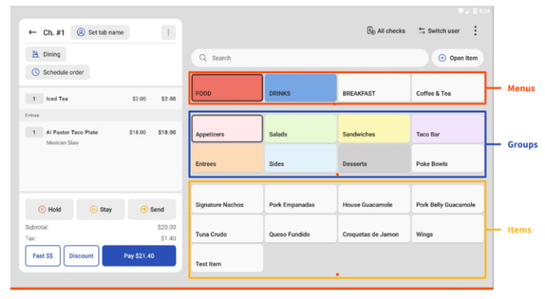
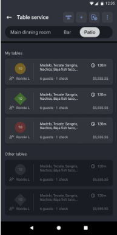
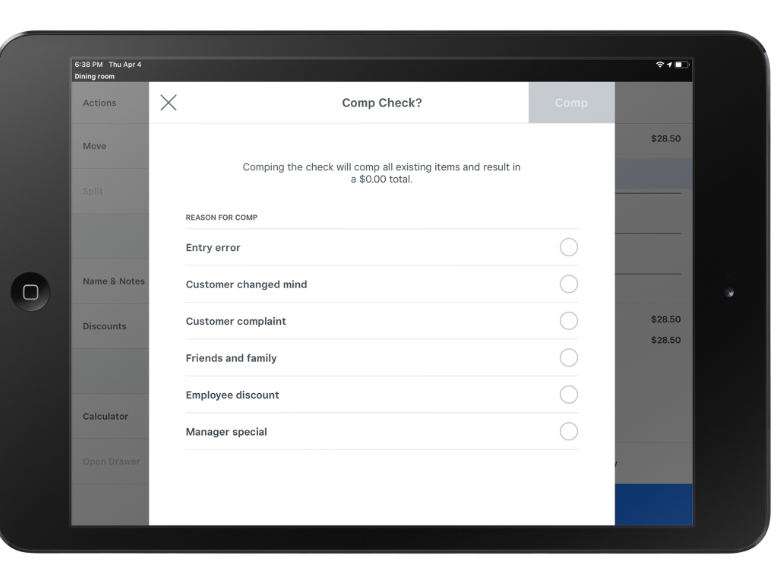
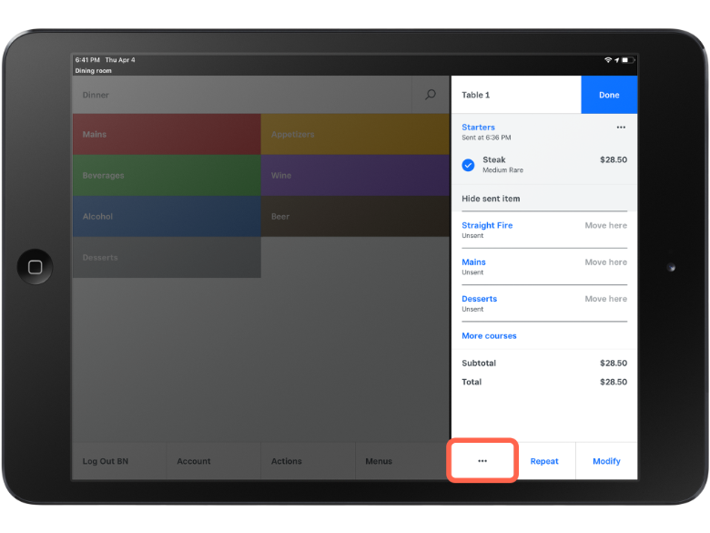
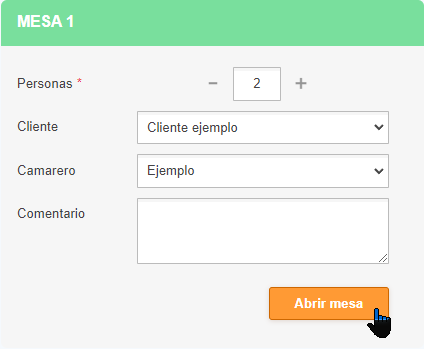
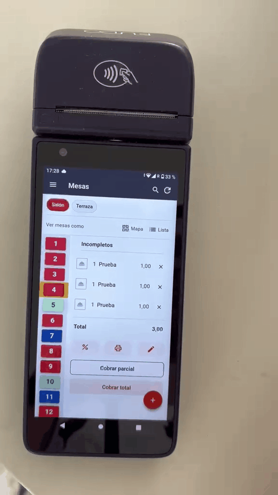
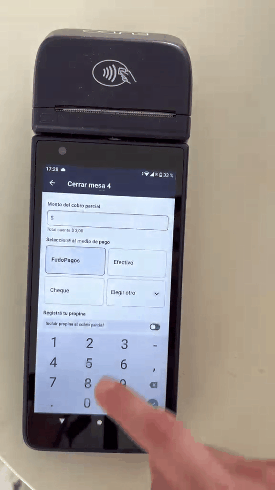
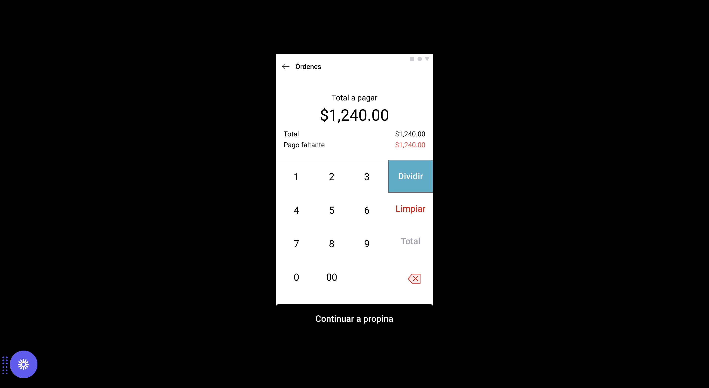
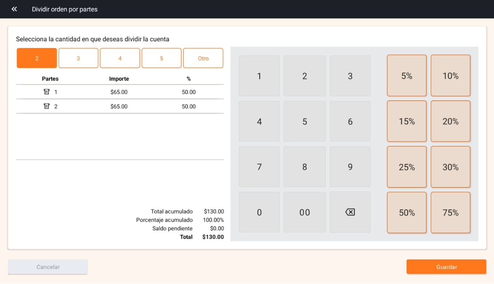
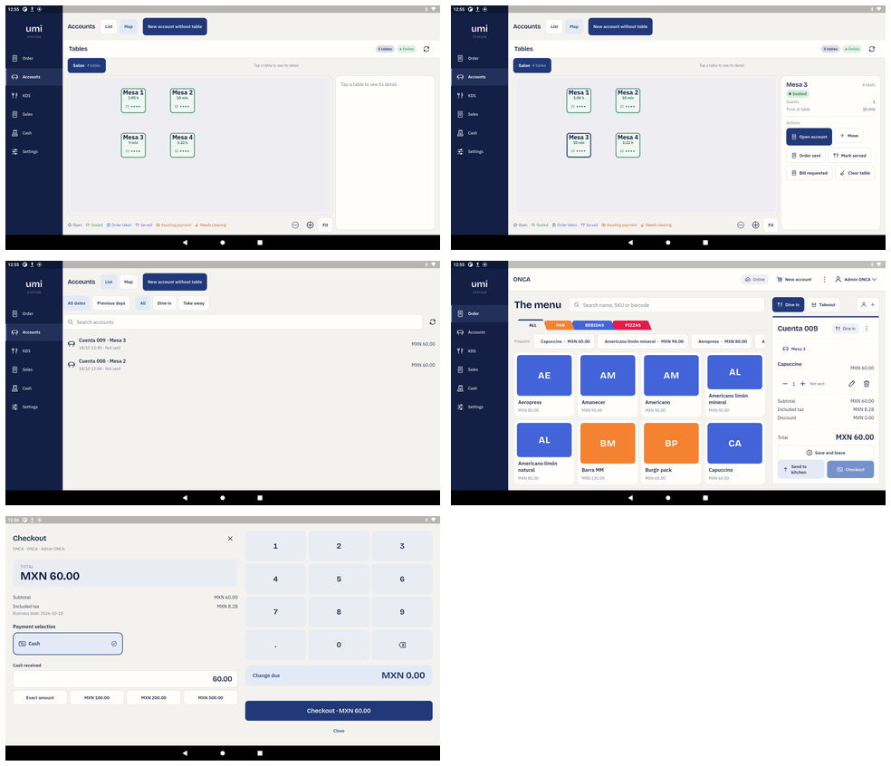

# Table, account and split-check flows: competitive review

Date: 2026-10-18

Question: how do restaurant POS products let staff start an order, open or find
an account, choose a table, edit the order, move or split items, attach a
customer, request payment and split the check? Where does Umi currently make the
operator think harder than the competition?

Labels:

- **HD** — documented fact or product image in a provider's own help material.
- **LC** — reading of a public product screenshot, not execution of a licensed POS.
- **IV** — independent seller/operator report from a vendor community.
- **HL** — local Umi behavior or screenshot.
- **I** — inference or recommendation for Umi.

## Short answer

**I:** Umi is not unintuitive because it lacks functions. It has the menu,
accounts, tables, editing, checkout, partial payment and table state. The
friction comes from presenting those functions as parallel entry points:
`Order`, `Accounts`, `Map`, `List`, `New account`, `New account without table`,
`Open account`, `Save and leave`, `Send to kitchen` and `Checkout`.

The strongest competitors make one object persistent — the **account/check/tab**
— and make the table its **location**. The operator returns to the same account,
not to a separate "order mode" and "accounts mode". The next action is visible,
and the table map carries enough money, guest and service information to decide
what to do without opening every table.

## What the competition is doing

| Stage                | Square                                                                                                                              | Toast                                                                                               | Lightspeed                                                                           | Fudo MX                                                                                     |
| -------------------- | ----------------------------------------------------------------------------------------------------------------------------------- | --------------------------------------------------------------------------------------------------- | ------------------------------------------------------------------------------------ | ------------------------------------------------------------------------------------------- |
| Start                | Tap a table on the floor plan and enter guest count; add items and send. Open tickets are a separate, explicitly named flow. **HD** | New order screen carries tab name, table, guests, server, dining option and menu. **HD/LC**         | Direct sale or Table Service; items can carry seat and course. **HD**                | Open a table with party size, customer, waiter and comment, then add products. **HD/LC**    |
| Identify the account | Open ticket name, table or seat. Split check and split payment are different operations. **HD**                                     | Tab name, guest count, server and table; account menu also changes customer. **HD/LC**              | Order/check with covers and seats. **HD**                                            | Table number and current consumption; map/list show table states. **HD/LC**                 |
| Find/resume          | Floor plan or open-ticket search. **HD**                                                                                            | Floor plan, numeric check lookup or all checks. **HD/LC**                                           | Payments screen and table/seat views. **HD**                                         | Table map/list, table selected directly. **HD/LC**                                          |
| Edit                 | Order detail with Repeat, Modify, Move here and course grouping. **LC**                                                             | Item modifiers, repeat, hold, stay, send; account menu for customer, dining option and void. **LC** | Select items for payment; split shared items; seats and courses. **HD**              | Product search and editing on the open order. **LC**                                        |
| Split                | Split check by item/seat or split payment by amount. **HD**                                                                         | Split by item, seat or evenly; partial tenders remain on one check. **HD**                          | Split by covers, seats or selected items; partial payment amounts. **HD**            | By amount, person or item; tip is added to each partial charge. **HD**                      |
| Pay                  | Tip/settlement behavior is separate from the check split. **HD**                                                                    | Each guest adds a tip during that guest's payment. **HD**                                           | Payment amount, received amount and Add tip; overpayment can become gratuity. **HD** | Partial payment screen shows account total, amount, method, tip and final charge. **LC/HD** |
| Finish service       | Payment does not itself prove the physical table is clean and ready. **I from documented table states**                             | Paid, dirty and available are separate operational states. **HD**                                   | Reservations distinguish paid from departed. **HD**                                  | Table list keeps explicit table states. **HD**                                              |

### Square

Square's public model demonstrates the important distinction: splitting a
**check** moves items or seats; splitting a **payment** divides the amount due.
Its check screen exposes `Move`, `Split`, `Name & Notes`, discounts and other
check-level actions. The order detail keeps courses visible and offers `Move
here`, `Repeat` and `Modify`.

The separation is strong. The independent evidence also shows why the
implementation must be careful: sellers report duplicated kitchen tickets after
splitting, and automatic BOGO discounts disappearing when items move into
separate checks.

### Toast

Toast is the clearest example of a **persistent account with multiple physical
contexts**. The check header carries the table, party size, server and tab name.
The operator can hold, stay or send. The table screen is not only a map: its
"My tables" presentation includes server, guest count, checks, total and elapsed
time. A numeric lookup exists for the common "find check 263" request.

Toast's split documentation is also the clearest on kitchen consequences. The
kitchen ticket is a production artifact; a later financial decision about who
pays should not create another sandwich.

### Lightspeed

Lightspeed treats the check as one payment surface with progressive actions:
select items or covers, enter payment amount, enter received amount, add tip and
pay. It supports item, seat and cover splits. It also demonstrates a useful
micro-interaction: when the received amount is higher than the amount due, the
difference can become gratuity rather than making the check inconsistent.

### Fudo MX

Fudo opens from the table, but immediately establishes the account context:
party size, customer, waiter and comment. Its current terminal shows a compact
table list plus `Cobrar parcial` and `Cobrar total`. The partial-payment screen
keeps the full account total visible, offers payment method and tip, then ends
with a small explicit ledger:

`Cobro parcial + propina = total a cobrar`.

That last block is better than a free-floating validation message because the
operator can verify the arithmetic before touching `Cobrar`.

### Parrot and Soft Restaurant

Parrot is strong at the exact moment the guest asks to pay: one screen shows
`Total a pagar`, the red `Pago faltante`, a keypad, `Dividir`, and
`Continuar a propina`.

Soft Restaurant is precise: editable parts by amount or percentage, with
accumulated amount, accumulated percentage and pending balance. It is a useful
accounting control, but the table-and-percentage grid is cognitively heavier
than the guest conversation. Umi should use its arithmetic discipline without
copying its visual density.

## Screens that explain the patterns

### Persistent check and visible actions — Toast





### Check actions and item editing — Square





### Table opening and compact payment — Fudo







### One balance and one next step — Parrot



### Precise but dense split editor — Soft Restaurant



## Independent seller signals

These are public community posts, not vendor documentation:

- A small-tavern owner said staff had a hard time splitting checks and enrolled
  in Square for Restaurants Plus primarily for that function. [Square
  community](https://community.squareup.com/t5/Food-Beverage/Square-for-Restaurants-Plus-splitting-a-check/m-p/823452)
- A seller with one table and ten split checks asked for an easier way to view
  the whole check. That supports a hierarchical account view rather than ten
  unrelated tickets. [Square
  community](https://community.squareup.com/t5/Payments-Troubleshooting/When-you-have-1-table-but-10-splits-check/m-p/849613)
- Multiple sellers reported split tickets being sent to the kitchen again,
  including duplicate food after splitting or moving tables. [Square
  community](https://community.squareup.com/t5/Payments-Troubleshooting/Square-KDS-Duplicate-Tickets-when-Splitting-Checks/m-p/241602)
- A seller reported automatic BOGO discounts disappearing after item splits.
  The reply explains that item splitting creates separate checks; an even
  payment split does not move items. [Square
  community](https://community.squareup.com/t5/Payments-Troubleshooting/Automatic-Discounts-and-Split-Items-Workaround/m-p/806355)
- Toast operators have also reported abandoned zero-value open checks. Empty
  drafts should not become financial records. [Toast
  community](https://community.toasttab.com/t5/restaurant-operations/any-idea-how-to-eliminate-the-0-00-open-checks/m-p/16674)

**I:** these reports support a conservative split model: one account, a visible
remaining balance, and split operations that change payment allocation without
silently re-firing kitchen work or discarding account-level discounts.

## What Umi currently does



### Strengths

- The order screen already puts the menu and check beside each other. Account
  number, table, line subtotal and total are visible in one place.
- The table detail panel has explicit physical actions: Move, Order sent, Mark
  served, Bill requested and Clear table.
- The account list has date, service-type and search filters.
- Empty accounts are no longer saved.
- The one-account partial-payment ledger is the right accounting foundation.

### Friction

1. **Three doors to the same task.** A cashier can start from `Order`, from
   `Accounts > New account without table`, from the top bar's `New account`, or
   from a table's `Open account`. Without a clear rule, each door creates a
   different mental model.
2. **The table tile omits the information needed to decide what to do.** It
   shows name, elapsed time and seat dots. It does not show party size, server,
   account total, customer or kitchen/account state on the tile itself.
3. **The account list is a record list, not a work queue.** `Cuenta 009 · Mesa 3`,
   time, `Not sent` and total are useful, but the next action is absent.
4. **Account identity is split across controls.** The account number, table,
   customer, dining option and server do not read as one identity block.
5. **Item editing is limited compared with the competition.** Quantity, edit and
   delete are visible; seat/course, move line, split quantity and repeat are not
   part of the normal line-item interaction.
6. **Split is payment-first and buried at checkout.** Competitors let the
   operator think "split this check" from the check itself. Umi currently enters
   a partial-payment screen from checkout. That is understandable to a payment
   expert and less understandable to a server.
7. **Only amount splitting exists in the normal flow.** Square, Toast,
   Lightspeed, Fudo, Parrot and Soft all expose item, seat or person-based
   proposals as well as amount splitting. Umi's amount ledger is a good base but
   does not answer "these two items are Maria's".
8. **Color carries too much meaning.** Green currently means seated/occupied,
   while users often read green as available or successful. Status needs a label
   and next-action icon on every tile.

## Recommended interaction model

### 1. Make the account the primary object

**I:** an account should be understood as:

> `Account # + location/table + party + customer + server + current balance +
lifecycle state`

`Order` and `Accounts` become two views of that account, not two unrelated
modules.

### 2. Give every account one obvious next action

| State                      | Primary action                           |
| -------------------------- | ---------------------------------------- |
| Empty draft                | Add first item, or discard automatically |
| Has unsent items           | Send to kitchen                          |
| Sent, waiting              | Continue order                           |
| Bill requested             | Start payment                            |
| Partially paid             | Collect remaining balance                |
| Fully paid, guests present | Mark departed                            |
| Needs cleaning             | Mark clean                               |

Secondary actions belong behind one menu. Avoid presenting `Checkout`,
`Send`, `Save and leave`, `New account` and `Open account` with equal weight.

### 3. Make table tiles miniature account cards

Each occupied table should show:

- table and party size;
- customer name if attached;
- server;
- current total;
- elapsed time;
- kitchen/service state;
- one primary action.

Example:

```text
Mesa 3                  4 guests
Ana López · Luis         $420
Waiting for food · 18m   [Continue]
Bill requested           [Pay]
```

The map remains spatial, but it also becomes a work queue.

### 4. Simplify starting an order

Use one `Start order` action with three location choices:

1. Dine in → table
2. Counter
3. Takeaway

Then optionally capture name, customer, party size and server in the same
sheet. Do not make “account without table” a separate primary concept. A
counter order is still an account; “without table” is only one attribute.

### 5. Put account edit actions where the work happens

On each line item, expose a compact action sheet:

- quantity and modifiers;
- assign seat/course;
- move to another account or table;
- split quantity;
- repeat item;
- void with permission.

The account header should expose `Move`, `Merge`, `Split check` and `Request
bill`. These are account operations, not checkout tricks.

### 6. Split from the account, then pay

**I:** a split center should open from the account header with three modes:

- `Equal`: 2–N people, exact odd-cent allocation shown;
- `By amount`: free amount, remaining balance visible;
- `By item/seat`: select items or guests, show unassigned items before saving.

All modes create allocations inside **one account**, not disconnected empty
checks. A split that only decides who pays must not resend kitchen tickets or
strip account-level discounts.

The payment step should keep a fixed summary:

```text
Account total       $420.00
Already paid        $120.00
This portion        $150.00
Tip                  $25.00
Charge now          $175.00
Remaining           $150.00
```

This is the pattern Fudo and Parrot communicate best.

### 7. Separate payment from physical departure

Keep the existing separation between paid/closed and table state. A guest can
pay and remain seated; another can leave before the table is clean. The table
panel should never silently treat `Paid` as `Available`.

## Proposed first-use flow

```text
ACCOUNTS
[Floor plan] [List]                    [Start order]

Tap Mesa 3
┌ Mesa 3 · 4 guests · Ana López ──────────────┐
│ $420 · Waiting for food · 18m              │
│ [Continue order]  [Request bill]  [More]   │
└─────────────────────────────────────────────┘

Continue order
menu + account line items
each line: qty | seat | modifiers | move | more

Request bill / Split check
[Equal] [By amount] [By item/seat]
always visible: total / paid / remaining

Payment
amount + method + tip
charge now + remaining

Paid
[Guests still here] [Mark departed] [Print copy]
```

## What not to copy

- Do not copy Square's model where item splitting can look like new kitchen
  work. Keep kitchen production separate from financial allocation.
- Do not copy Soft Restaurant's percentage table as the default. Keep the
  arithmetic, hide the spreadsheet.
- Do not copy every competitor's nouns. Pick one vocabulary and use it
  everywhere: account, table, order line, payment, split, tip.
- Do not silently interpret overpayment as a tip unless the operator chooses an
  explicit “amount includes tip” option.

## Recommended validation with staff

Run these five scenarios on the iMin and the handheld:

1. Seat four guests, attach a customer, order items to two seats, send.
2. Return later, resume the account, add a second round, repeat one item.
3. Move one item to another guest and one guest to another table.
4. Split by item, then pay one guest with a tip; verify the remaining balance.
5. Pay the rest, keep the table occupied, mark departed, mark clean.

Measure taps, wrong-table selections, backtracks and requests for help. The
target is not “fewest controls”; it is that the next action is obvious without a
manager explaining the app.

## Sources

- Toast, [New POS ordering screens](https://support.toasttab.com/en/article/New-POS-Experience-Ordering-Screens)
- Toast, [Managing tables](https://support.toasttab.com/en/article/New-POS-Managing-Tables)
- Toast, [Starting a tab](https://support.toasttab.com/en/article/Starting-a-Tab-1492811100378)
- Toast, [Split checks](https://support.toasttab.com/en/article/Splitting-Checks-by-Item-1492811097734)
- Square, [Open tickets](https://squareup.com/help/us/en/article/5337-use-open-tickets-with-square)
- Square, [Manage checks](https://squareup.com/help/us/en/article/8166-manage-checks-with-square-for-restaurants)
- Square, [Take orders tableside](https://squareup.com/help/us/en/article/8152-take-orders-tableside-with-square-for-restaurants-mobile-pos)
- Square, [Split a check or payment](https://squareup.com/help/us/en/article/8165-split-a-payment-and-check-with-square-for-restaurants)
- Lightspeed, [Processing payments](https://k-series-support.lightspeedhq.com/hc/en-us/articles/360051089473-Processing-payments)
- Lightspeed, [Check splitting](https://k-series-support.lightspeedhq.com/hc/en-us/articles/360051089493-Check-splitting)
- Fudo, [Opening tables](https://soporte.fu.do/es/articles/11730839-1-abrir-mesas)
- Fudo, [Splitting the account on the MX terminal](https://soporte.fu.do/es/articles/14627530-terminal-de-fudo-mx-como-dividir-la-cuenta)
- Parrot, [Splitting equally](https://soporte.parrotsoftware.com.mx/pagos-pay/como-dividir-una-cuenta-en-partes-iguales)
- Soft Restaurant, [SRC mobile manual](https://softrestaurant.zohodesk.com/portal/es/kb/articles/manual-src-móvil)
- Odoo, [Restaurant POS](https://www.odoo.com/documentation/19.0/applications/sales/point_of_sale/restaurant.html)

## Limits

No competitor POS was executed with a licensed account. Official screenshots
and text were used for product behavior; Square community threads were used only
for independent operator friction. No formal usability study, click-count
measurement or A/B test was performed. The Umi screenshots show staging test
data.
